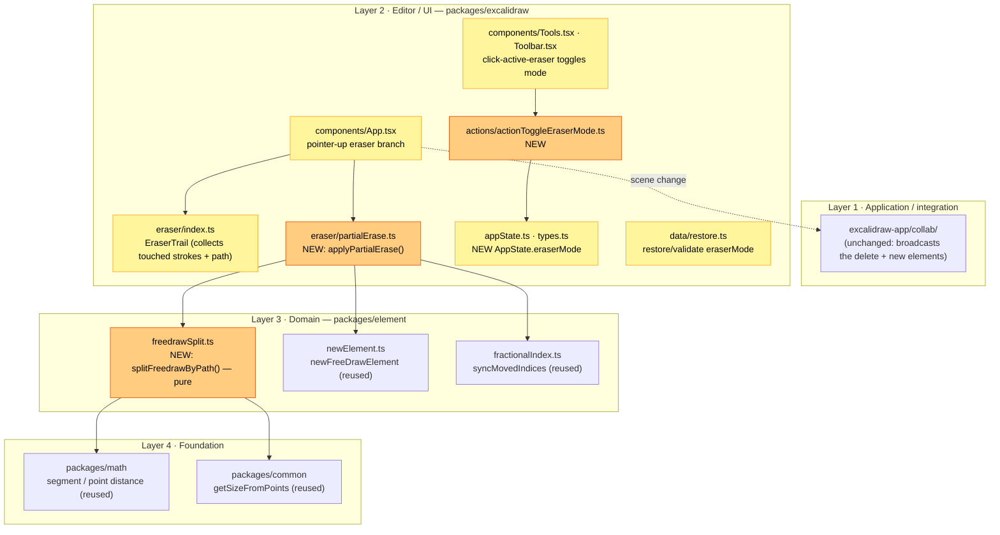

# Design: Partial Eraser for Freehand Strokes

|  |  |
| --- | --- |
| **Status** | Proposed. This note is written before the implementation and will become ADR-001 in Part 2. |
| **Date** | 2026-11-18 |
| **Author** | Allie (fork `mendozaa0130/excalidraw`) |
| **Base commit** | `930f40c78` (merge of upstream `d732d4f3d`) |
| **Related** | [Logical architecture](logical-architecture.md), [security analysis](security-analysis.md), [design patterns](design-patterns.md), A7 eraser work ([`a7-tdd/`](a7-tdd/README.md)) |

## 1. What the feature does

The eraser currently works on whole elements. If the eraser path touches any part of a stroke, the entire stroke is deleted, and if that stroke is in a group, the whole group is deleted too (`packages/excalidraw/eraser/index.ts`, `EraserTrail.updateElementsToBeErased`). This feature adds a second **eraser mode, `partial`**. In this mode, dragging the eraser across a freehand (`freedraw`) stroke removes only the part of the stroke under the eraser:

- If the eraser crosses the **middle** of a stroke, the stroke splits into two strokes.
- If it crosses the **end** of a stroke, the stroke gets shorter.
- If it covers the **whole** stroke, the stroke is deleted.
- If it crosses the same stroke **several times** in one drag, the stroke splits into several pieces.

The user switches between `element` mode (the current behavior and the default) and `partial` mode. Clicking the eraser button while the eraser is already active toggles the mode. This works the same way as the existing selection/lasso toggle, where clicking the active selection tool switches to lasso (`packages/excalidraw/components/Tools.tsx:343–350`). The choice is stored in a new public AppState field, `eraserMode`.

### Who asked for it

The request comes from Excalidraw users and maintainers, and it has gone unbuilt for over four years:

- **[#4904](https://github.com/excalidraw/excalidraw/issues/4904)**, "non-atomic erasing for linear & freedraw shapes." A maintainer (dwelle) opened it on 2022-03-11. It is labeled `discussion` with "consensus not reached." The issue body specifies that the eraser "should split the shape into two when a middle point is removed" and that "if we implement this we should make this opt-in."
- **[#9199](https://github.com/excalidraw/excalidraw/issues/9199)**, "Eraser Tool Erases Entire Stroke Instead of Partial Erasing," opened 2025-02-28. A maintainer (Mrazator) replied: "IMO partial removal makes sense as well … so I'll leave this one in the backlog." A 2026-08-22 comment from a contributor proposes limiting the feature to freedraw and asks whether it should be a mode or a modifier, and whether tiny fragments should be dropped. This design answers both questions in §2.
- **[#10332](https://github.com/excalidraw/excalidraw/issues/10332)** (2025-11-13) reports the same problem for lines and freehand strokes and is linked as a duplicate of #9199.

The main users are people who write or sketch with a pen or tablet. For them, a "stroke" is whatever they drew between pen-down and pen-up, which is often a whole word or a long squiggle. Deleting all of it to fix one mistake is the complaint in all three issues.

### Acceptance criteria

1. **Default unchanged.** With `eraserMode` at its default value `"element"`, all existing eraser tests (`packages/excalidraw/eraser/eraser.test.ts`, `packages/excalidraw/tests/*`) pass unchanged.
2. **Middle cut.** In `partial` mode, dragging across the middle of a single freedraw stroke leaves two non-deleted freedraw elements and marks the original `isDeleted: true`. Every remaining point is more than the erase tolerance away from the eraser path.
3. **End trim.** Erasing across one end leaves one shorter stroke.
4. **Full cover.** Erasing across the entire stroke leaves no non-deleted fragments.
5. **Style preserved.** Each fragment keeps the original's `strokeColor`, `backgroundColor`, `strokeWidth`, `opacity`, `roughness`, `strokeOptions`, `simulatePressure`, `groupIds`, `frameId`, `link`, `locked` (always `false` here, since locked strokes are skipped) and `customData`. Each fragment's `pressures` stay aligned index-for-index with its `points`.
6. **Geometry preserved.** The parts of the stroke that were not erased render in the same scene positions as before. Each fragment's `x`/`y` is rebased so that its first point is `[0, 0]`, and its `width`/`height` matches its points.
7. **One undo step.** A single drag produces exactly one history entry. One undo restores the original stroke, and redo re-applies the split.
8. **Only freedraw is affected.** In `partial` mode, the eraser does not delete or change rectangles, text, arrows, lines, images or any other non-freedraw element.
9. **Locked strokes untouched.** Locked strokes are not cut, matching the current `!el.locked` filter.
10. **Tiny fragments dropped.** A fragment with fewer than 2 points, or with a path length below `MIN_FRAGMENT_LENGTH` (scene units, initially 1 / zoom), is not created.
11. **Mode toggle works.** Clicking the active eraser button toggles `eraserMode`. The value is restored after a page reload (browser storage) and is never written into exported files or sent to collaborators.
12. **Hosts can control it.** A host app can set the mode via `initialData.appState.eraserMode` or `updateScene({ appState: { eraserMode } })`, and sees it in `onChange`. Invalid values are replaced by the default during restore.

### What it deliberately will not do

- **No partial erasing for lines, arrows or shapes.** Lines and arrows have bindings, arrowheads, curves (`roundness`) and an editor for their points, so cutting them raises a separate set of questions. Rectangles, ellipses and diamonds are parametric shapes, so "half a rectangle" cannot be represented without turning them into something else. This is the same scope that the #9199 proposal suggests.
- **No pixel or raster erasing.** Nothing is masked. Erasing always produces ordinary vector strokes.
- **No live preview of the cut during the drag.** During the drag the user sees the existing fading eraser trail. The split is computed and applied once, on pointer-up. A live preview would require renderer changes, which is the coupling Approach A is chosen to avoid (§2).
- **No modifier key.** There is no "hold a key to erase partially." See §2, Approach C.
- **No new element type, no schema change.** Fragments are normal `freedraw` elements.
- **No merging.** Strokes that touch are not joined back together.
- **No change to how `element` mode treats groups.** In `partial` mode, cutting one stroke in a group does _not_ expand to the rest of the group, because the user is editing ink rather than deleting objects. Whole-element mode keeps its current group behavior.

## 2. Approaches considered

The core question is how to represent "a stroke with a piece missing." Two credible answers come out of the upstream discussion (#4904 and #9199). The other questions are smaller choices that sit around that one.

### Approach A: Split the stroke into new freedraw elements (**chosen**)

On pointer-up, for each freedraw stroke the eraser touched, compute which of its points fall within the erase tolerance of the eraser path. Then cut the point list into the runs that survive. At each cut, add an interpolated point on the tolerance boundary so the visible edge lands where the eraser was, rather than at the nearest sample point (the #4904 spec asks for this). The original element is marked `isDeleted: true`, and each surviving run becomes a new `freedraw` element created via `newFreeDrawElement` with the original's style copied. The fragments are inserted at the original's z-position (fractional index) so layering does not change.

**For:**

- **No change to the data model.** A fragment is indistinguishable from a stroke the user drew. Renderers (canvas, SVG export, `renderElement.ts`), hit-testing, bounds, `restore.ts`, collaboration reconciliation and older Excalidraw clients already handle it, so the change stays in a few places.
- **Collaboration works as-is.** The change consists of one element deletion plus N new elements. That is exactly what the reconciler in `packages/excalidraw/data/reconcile.ts` already merges, by `id` and `version`.
- **Undo is free.** A single `store.scheduleCapture()` before `scene.replaceAllElements()` produces one `StoreDelta` containing both the deletion and the additions, so one undo reverses both (Diagram 1 in [logical-architecture.md](logical-architecture.md)).
- **The splitting is a pure function** of points in and fragments out, so it can be unit-tested without rendering `<Excalidraw>`. That avoids the testing cost A3 identified for `Store`.

**Against:**

- **Element IDs change.** Anything keyed on the original ID breaks: `#element=<id>` deep links, host apps storing per-element metadata outside `customData`, and comment threads anchored to an element. I accept this because erasing already deletes IDs today, and partial erasing is an explicit, opt-in action.
- **Elements multiply.** A scribbly stroke erased in many places can become many elements, which makes the scene larger. Mitigation: acceptance criterion 10 drops tiny fragments.
- **Stroke width is approximate at the cut.** A freedraw outline is generated from the whole point list by `perfect-freehand` (variable width, tapering ends, `strokeOptions.streamline`). A fragment's outline is regenerated from its own points. As a result, the width near a cut can change slightly, and the new ends taper as if the stroke started or ended there. This is visible on close inspection. I accept it: the alternative is Approach B.

### Approach B: Keep one element and record the erased ranges on it (**rejected**)

Add a field to `ExcalidrawFreeDrawElement`, for example `erasedRanges: [startIndex, endIndex][]` or an eraser mask path (an SVG `<mask>`, suggested in #4904 by a commenter). Each renderer then skips or masks those parts.

**For:**

- **The element ID is stable**, so deep links and external metadata survive.
- **The outline does not change.** The `perfect-freehand` outline is computed from the full point list, so there are no artifacts at the cuts.
- **It is reversible** in principle ("un-erase" by clearing ranges).

**Why it is rejected:**

1. **It changes the file format.** A new field on a persisted element type has to be handled by `restore.ts`, by the canvas renderer (`packages/element/src/renderElement.ts`), by the SVG renderer (`packages/excalidraw/renderer/staticSvgScene.ts`), by hit-testing (`collision.ts`, `distance.ts`, and the A8 geometry strategies in `elementGeometry.ts`), by bounds (`bounds.ts`), and by the eraser itself. That is a change across at least three packages, for one tool option.
2. **Older readers would show erased ink.** A collaborator on an older client, an older embedded `@excalidraw/excalidraw` version, or a third-party reader such as the Obsidian plugin would ignore the unknown field and render the erased ink. For a user who erased something because they did not want it seen, that is a confidentiality failure, not just a visual glitch (§6).
3. **"Erased" ink would stay in the live element forever,** not only in a tombstone. It would be exported in every save and share link (see §6).
4. **It has unclear semantics for everything else.** What are the bounds of a stroke whose middle is masked: the full stroke or only the visible parts? Does a click on the hidden part select it? Do the arrow-binding and snapping code paths need to know? Each answer adds another special case for freedraw, and the A8 Strategy refactor was meant to reduce those.

### Approach C: A modifier key on the existing eraser (**rejected**)

Holding a key while erasing would cut instead of delete. This was raised as an option in #9199.

**Why it is rejected:**

- **Alt is already taken.** While erasing, `Alt` _restores_ elements that are pending deletion (`App.handleEraser` passes `event.altKey` as `restore`, and the hint string is `eraserRevert` in `locales/en.json`).
- **Pen and touch users can't press it.** The main audience for this feature draws with a pen or finger and has no modifier key. A persistent mode works on every input device.

### Approach D: A separate tool type, like `lasso` (**rejected**)

Adding `"partialEraser"` to `ToolType` would copy how lasso became its own `ToolType` with a `preferredSelectionTool` AppState field.

**Why it is rejected:** The editor checks `activeTool.type === "eraser"` in at least seven places: `App.tsx:4393`, `:7202`, `:7912`, `:7929`, `:11114`, `Actions.tsx:245`, and `isEraserActive` in `appState.ts:338`. Each of those would need a second case, and so would every host app that switches on `activeTool.type`. A mode field on the eraser keeps `activeTool.type === "eraser"` true in both modes. I do keep the lasso precedent for the **UI gesture**: clicking the active tool toggles the variant.

### Smaller decisions

| Decision | Chosen | Rejected alternative and why |
| --- | --- | --- |
| When to apply the cut | Once, on pointer-up | **Live, on every pointer-move.** This would mutate the scene on every move, so the collaboration layer would broadcast intermediate states, and `Alt`-restore would have to rebuild elements that had already been split. |
| What counts as erased | Points within `tolerance = max(2.25, 5 / zoom) + strokeWidth / 2` of any eraser path segment. This is the same tolerance `freedrawEraserTest` already uses, widened by half the stroke width. | **Testing against the `perfect-freehand` outline polygon.** The outline has no one-to-one mapping back to input points, so the result could not be turned into a cut location. |
| Point removal | Cut at the tolerance boundary, adding interpolated points | **Delete the nearest sample point** (suggested in #9199). The width of the erased gap would then depend on how densely the stroke was sampled rather than on where the eraser went. |
| Tiny fragments | Drop them (criterion 10) | **Keep them.** That leaves invisible specks that still take part in selection and bounds, which answers the question raised in #9199. |
| Where the mode lives | `AppState.eraserMode`, persisted to browser storage only | **A prop on `ExcalidrawProps`.** That would let a host fix the mode, but the user could not change it. A host can still force the mode via `updateScene`. |

## 3. Where it sits in the architecture

The feature touches three of the four layers from [logical-architecture.md](logical-architecture.md), and all of the new dependencies point **downward**. It adds no new arrows to the [layering-violations diagram](logical-architecture-violations.png).

Source: [`docs/design-partial-eraser-architecture.mmd`](design-partial-eraser-architecture.mmd). The full A3 diagram with the feature marked is [`docs/logical-architecture-partial-eraser.mmd`](logical-architecture-partial-eraser.mmd).

**Placement rationale:**

- **The geometry goes in the domain layer (`packages/element`).** `splitFreedrawByPath(element, eraserPath, tolerance)` only needs element data and math. It has no dependency on `App`, `AppState` or React, so it is placed in the layer that already owns `getFreedrawOutlinePoints` and the other freedraw geometry. Placing it in the editor layer would have been easier, but it would repeat the A3 problem of domain logic that can only be tested by rendering the editor.
- **The orchestration goes in the editor layer (`packages/excalidraw/eraser/`).** `applyPartialErase(scene, touchedIds, eraserPath, zoom)` decides which elements to cut, creates fragments, assigns fractional indices and returns the next elements array. It lives next to `EraserTrail` because it needs the eraser path and editor state such as zoom.
- **`App.tsx` changes as little as possible.** The pointer-up eraser branch gains one `if (eraserMode === "partial")` that calls `applyPartialErase` and then the existing `scheduleCapture` / `replaceAllElements` pair.
- **The application layer (`excalidraw-app/`) does not change.** Collaboration, Firebase persistence and share links see ordinary element changes.

## 4. Existing code that has to change, and what that says about coupling

| File | Change | Why it has to change |
| --- | --- | --- |
| `packages/excalidraw/types.ts` | Add `eraserMode: "element" \| "partial"` to `AppState` | The public type |
| `packages/excalidraw/appState.ts` | Default value, plus `APP_STATE_STORAGE_CONF` entry `{ browser: true, export: false, server: false }` | Every AppState key must be declared here, or typechecking fails |
| `packages/excalidraw/data/restore.ts` | Validate `eraserMode` in `restoreAppState` | AppState values that come from storage or the host are untrusted (§6) |
| `packages/excalidraw/eraser/index.ts` | `EraserTrail` keeps the full eraser path for the gesture and, in partial mode, collects only freedraw candidates without expanding groups or bound text | It currently keeps only the last segment and always expands groups |
| `packages/excalidraw/components/App.tsx` | Branch in the pointer-up eraser handling (around `:10134`). `eraseElements` stays as is. | **This is the only place that commits an eraser gesture** |
| `packages/excalidraw/components/Tools.tsx`, `Toolbar.tsx` | Click-active-eraser toggles the mode, and the button shows which mode is active | UI |
| `packages/excalidraw/locales/en.json` | Labels and hint text for the mode | i18n |
| `packages/excalidraw/eraser/eraser.test.ts`, `tests/` | New tests | §8 |
| _(new)_ `packages/element/src/freedrawSplit.ts`, `packages/excalidraw/eraser/partialErase.ts`, `packages/excalidraw/actions/actionToggleEraserMode.ts` | New code |  |

**What the list says about coupling:**

1. **The eraser's state and lifecycle are split between `EraserTrail` and `App`.** `EraserTrail` decides _what_ is hit. `App` owns `elementsPendingErasure`, the pointer-up decision, the click-without-drag special case (`draggedDistance === 0`), and `eraseElements()`, which also unbinds arrows. So adding an eraser behavior means editing the 14,000-line `App.tsx` again, inside the low-cohesion pointer-up handler that A3 already identified as a GRASP violation. A cohesive design would have one `Eraser` object with `begin / move / commit / cancel`, and `App` would just forward events to it.
2. **Rendering knows about erasing.** `renderElement.ts`, in the domain layer, takes `elementsPendingErasure` as a render-config field and fades those elements. A tool's transient UI state has leaked into a lower layer. This is why a live partial preview is a non-goal: it would mean teaching the renderer how to draw half an element.
3. **Adding a public AppState field touches at least four files** (type, default, storage config, restore). This is typical of how AppState sits in the editor layer even though lower layers depend on it (violations ② and ③ in A3). It is coupling, but it is the _good_, explicit kind: the storage config forces the author to decide whether a field is persisted and where.
4. **Positive finding: no renderer, collaboration, persistence or file-format code changes.** Approach A depends only on the element model's public contract (`newFreeDrawElement`, `isDeleted`, fractional indices). The element model and everything downstream of it are therefore loosely coupled to the tools that produce elements.

## 5. GRASP principles and design patterns

**Used:**

- **Information Expert.** `splitFreedrawByPath` is in `packages/element` with the rest of the freedraw geometry, because that package holds the knowledge it needs: the `points`/`pressures` layout, local coordinates relative to `x`/`y`, and how `width`/`height` derive from points.
- **Pure Fabrication.** `applyPartialErase` is not a domain concept. It is a service object that exists to keep the "turn touched strokes into fragments" logic out of `App` and out of `EraserTrail`, whose job is hit-testing during the drag.
- **Low Coupling and Protected Variations.** Approach A was chosen _because_ it keeps the variation (a new way of erasing) behind the stable element-model interface. Renderers, collaboration and persistence do not change. Approach B would have spread the variation across all of them.
- **Factory** (from [design-patterns.md §2](design-patterns.md)). Fragments are created through the existing `newFreeDrawElement` factory and are never built as literal objects. As a result, they get valid `id`, `seed`, `version`, `versionNonce` and `updated` fields, which collaboration reconciliation depends on.
- **Command and Polymorphism via `Action`.** The mode toggle is an `Action` (`actionToggleEraserMode`), like `actionToggleGridMode` and `actionToggleMinimap`. `ActionManager` dispatches to it without any new branching (A3, "Applied well #2").
- **Observer** (existing). History is not called directly. `store.scheduleCapture()` leads to `Store.commit()`, which emits a `DurableIncrement`, and `History.record()` picks it up. That is how the "one undo step" criterion is met without the feature knowing that `History` exists.

**Deliberately avoided:**

- **A Strategy object for eraser modes** (`EraserStrategy` with `WholeElementEraser` / `PartialStrokeEraser`). This is the design I _would_ choose, following my A8 argument for Strategy over type switches. I am not using it because the project's style forces a different design: the whole-element behavior is not one unit that could become a strategy. It is spread across `EraserTrail.updateElementsToBeErased`, `App.elementsPendingErasure`, the `draggedDistance === 0` branch in `App`'s pointer-up handler, `App.eraseElements` (which also unbinds arrows), and `renderElement.ts`. Extracting it into a strategy is a refactor of `App.tsx` that a maintainer would reasonably reject as part of a feature PR. So the feature adds **one** `if (eraserMode === "partial")` branch in `App` and keeps everything after that branch in new, cohesive modules. I am recording this as a known compromise. If a third eraser mode is ever added, that is when to extract the strategy.
- **Adding to `App.tsx` beyond the branch.** All new logic lives in new files, so the low-cohesion handler grows by a few lines and not by a few hundred.

## 6. Security implications

This section uses the vocabulary and labels of [security-analysis.md](security-analysis.md): trust boundaries TB1–TB8 and crossings 1–12.

**New entry points: none.** The feature adds no network calls, file formats, URL parameters, iframes or external hosts. All new code runs inside **TB1 (the drawer's browser)**.

**New input that crosses an existing boundary: `AppState.eraserMode`.** It can arrive in three ways:

- From browser `localStorage`, on reload. This is restored inside TB1.
- From a host application via `initialData` / `updateScene`. This is the npm-embedding path, so the input is trusted only as far as the host is.
- From an imported `.excalidraw` file (crossing 4a). Because the field is configured `export: false`, the editor never writes it. A crafted file could still include it.

`restoreAppState` therefore treats the value as untrusted. Anything other than `"element"` or `"partial"` becomes `"element"`. The field is configured `server: false`, so it never crosses into **TB3/TB4** (relay, Firebase) through crossings 2 or 3.

**Assets.** The asset concerned is the **scene content**: the drawing itself, which the A5 threat model treats as confidential behind the room key.

- **Data remanence: "erased" is not "gone."** The original stroke stays in the scene as an `isDeleted: true` tombstone with its full `points` array. It also stays in the undo stack and is broadcast to collaborators through crossing 2, which is how deletions propagate. Based on reading the code, it is also included in saved `.excalidraw` files, because `ActionManager` passes `getElementsIncludingDeleted()` to the save actions and `serializeAsJSON` does not filter `isDeleted` (`packages/excalidraw/data/json.ts:52`). The implementation will add a test that confirms or rules this out. **This is not new.** Whole-element erasing and Delete behave the same way today. Partial erasing makes it more relevant, though: a user who erases a word they wrote by mistake may reasonably assume it is gone. I am documenting this rather than changing it, because changing tombstone retention would break collaboration reconciliation, which needs tombstones to propagate deletions. This is the main reason Approach B was rejected on security grounds (§2): under B, the erased ink would be in the **live** element, and older clients would render it.
- **Integrity.** Fragments are ordinary elements with fresh `version`/`versionNonce` values. The A5 finding still applies: version numbers from collaborators are "trusted as sent" (crossing 2). A malicious collaborator could already overwrite any element, so this feature does not widen that.

**Availability (resource use).** Cutting is O(points × eraser segments) per touched stroke and runs once, on pointer-up. A crafted scene with a freedraw element containing hundreds of thousands of points (crossings 4a/4b/2) could make a partial-erase pause the tab. Mitigations:

- Run the same cheap bounds check `eraserTest` already does before any per-point work.
- Test only the points whose bounding box overlaps the eraser path.

This is the same class of risk as rendering such an element, which already happens on load, so it is not a new trust-boundary crossing.

## 7. Backward compatibility

| Who | What happens |
| --- | --- |
| **Existing users** | No change unless they turn partial mode on. The default `eraserMode` is `"element"`, which is today's behavior. The `Alt`-to-restore behavior and the click-to-erase behavior in element mode are unchanged. |
| **Existing data** (`.excalidraw` files, `localStorage`, Firebase scenes, share links) | No migration is needed, because the element schema does not change. Old scenes load as before. `eraserMode` is missing from old saved app state, so `restoreAppState` fills in the default. |
| **Files written by the new version, read by an old version** | They open correctly. Fragments are standard `freedraw` elements, and the original is a standard tombstone. This was the deciding advantage over Approach B. |
| **Mixed-version collaboration** | Works. An older client receives one deletion and N new elements through the existing reconcile path. It cannot _create_ partial erases, but it renders them correctly. |
| **Host apps embedding `@excalidraw/excalidraw`** | `AppState` gains a field, so `onChange` consumers see it. Hosts that pass a partial `appState` to `initialData` or `updateScene` are unaffected. TypeScript code that builds a _complete_ `AppState` object literal (rare outside tests; `getDefaultAppState()` is the supported route) will need the new field. This is a **minor**, additive API change, recorded in `packages/excalidraw/CHANGELOG.md`. |
| **Hosts that switch on `activeTool.type`** | Unaffected. It is still `"eraser"` in both modes (the reason Approach D was rejected). |
| **Element IDs** | **Behavior change, in partial mode only:** a cut stroke's ID is replaced by new fragment IDs. `#element=` links and host metadata keyed on that ID stop resolving, just as they would if the stroke were deleted. Fragments copy `customData` and `link`, so data carried _on_ the element survives. |

## 8. Test plan (summary, detailed in Part 2)

- **Unit (`packages/element`), `splitFreedrawByPath`:** no overlap; middle cut; cut at start; cut at end; multiple cuts; full cover; a stroke with one point (see A7, #11945); `pressures` empty vs. populated (`simulatePressure`); boundary interpolation; rebasing to `[0, 0]`; `width`/`height`; dropping tiny fragments; tolerance scaling with zoom.
- **Unit (`packages/excalidraw`):**
  - `applyPartialErase`: z-order is kept via fractional indices; style is copied; locked strokes, non-freedraw elements and groups are skipped.
  - `restoreAppState`: invalid `eraserMode` falls back to the default.
- **System (through the editor, using `tests/helpers` `API`, `UI`, `Pointer`):** render `<Excalidraw>`, draw a freedraw stroke with the pointer, switch the eraser to partial mode by clicking the active eraser button, drag across the stroke, and assert two non-deleted freedraw elements. Then press `Ctrl+Z` and assert one element with the original ID, then press `Ctrl+Shift+Z` and assert two again. A second system test checks that a rectangle under the same drag survives.

## 9. Open questions to revisit in the ADR

- Should `MIN_FRAGMENT_LENGTH` scale with `strokeWidth` as well as zoom?
- Should partial mode eventually cover non-rounded `line` elements? That would mean deciding what happens to `polygon` lines and to `startBinding`/`endBinding` on arrows.
- Should upstream get a "purge deleted elements on save" option? It would address the data-remanence point in §6 for every eraser mode, not just this one.
