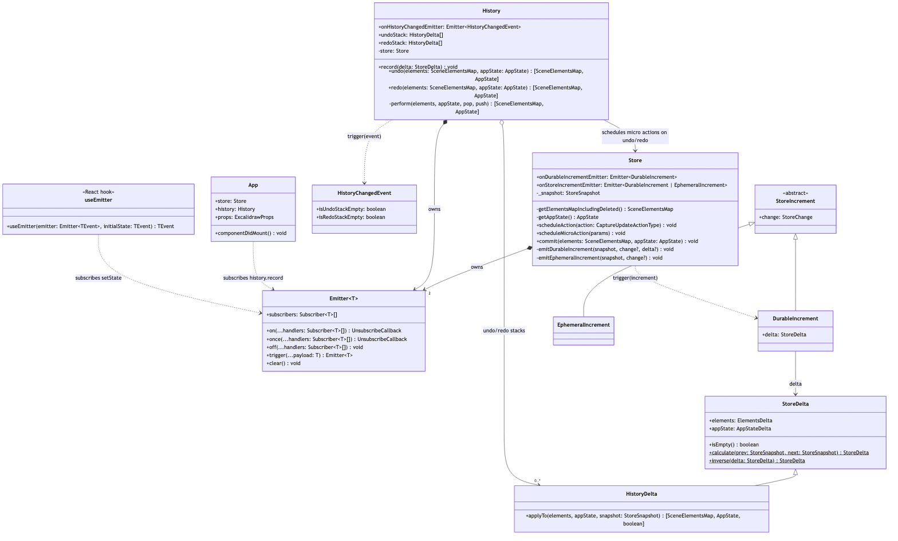
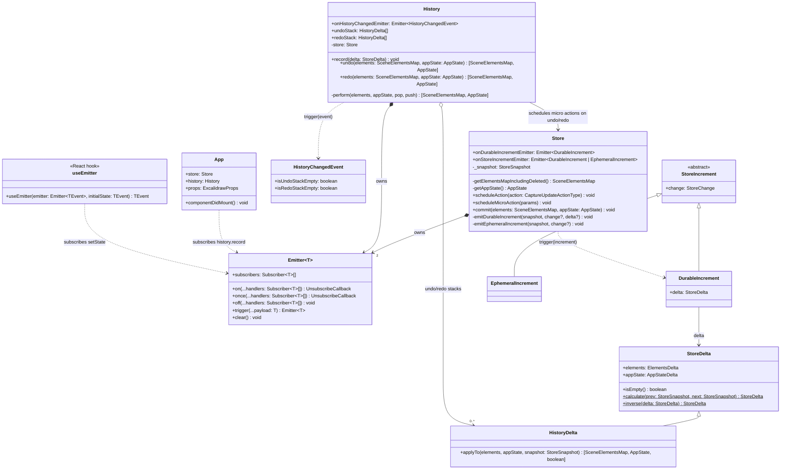
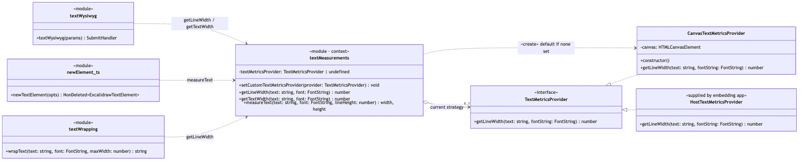
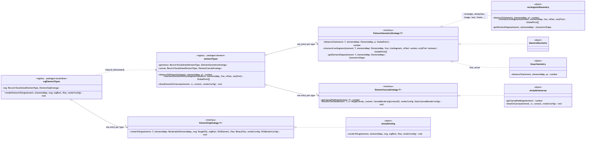
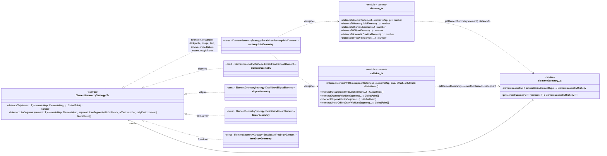

```mermaid
%% Factory (Simple Factory / factory functions) — element creation
%% Factory:   packages/element/src/newElement.ts — 11 exported new*Element functions, all built on _newElementBase (:87)
%% Products:  ExcalidrawElement and its subtypes (packages/element/src/types.ts) — TypeScript type aliases, not classes
%% Clients:   75 call sites in 18 non-test files, e.g.
%%            App (components/App.tsx:5075, :9948, :10118, :10293, :10320)
%%            convertToExcalidrawElements (packages/element/src/transform.ts:572, switch at :607-705)
%% Note: GoF "Factory Method" defers creation to subclasses; here a module of functions plays the creator role.

classDiagram
    direction LR

    class newElement_ts {
        <<module · factory>>
        -_newElementBase~T~(type: T.type, opts: ElementConstructorOpts) ExcalidrawGenericElement
        +newElement(opts: type + ElementConstructorOpts) NonDeleted~ExcalidrawGenericElement~
        +newTextElement(opts: text, fontSize?, fontFamily?, … + ElementConstructorOpts) NonDeleted~ExcalidrawTextElement~
        +newLinearElement(opts: type, points? + ElementConstructorOpts) NonDeleted~ExcalidrawLinearElement~
        +newArrowElement~T~(opts: type, elbowed?: T, points?, … + ElementConstructorOpts) NonDeleted~ExcalidrawArrowElement~
        +newImageElement(opts: type, fileId?, status?, scale?, crop? + ElementConstructorOpts) NonDeleted~ExcalidrawImageElement~
        +newFreeDrawElement(opts) NonDeleted~ExcalidrawFreeDrawElement~
        +newFrameElement(opts) NonDeleted~ExcalidrawFrameElement~
        +newStickyNoteElement(opts) NonDeleted~ExcalidrawStickyNoteElement~
    }

    class ExcalidrawElement {
        <<type>>
        +id: string
        +type: string
        +x: number
        +y: number
        +seed: number
        +version: number
        +versionNonce: number
        +index: FractionalIndex | null
        +isDeleted: boolean
        +updated: number
    }
    class ExcalidrawTextElement {
        <<type>>
        +text: string
        +fontSize: number
        +fontFamily: FontFamilyValues
        +containerId: string | null
    }
    class ExcalidrawLinearElement {
        <<type>>
        +points: LocalPoint[]
        +startBinding: Binding | null
        +endBinding: Binding | null
    }
    class ExcalidrawArrowElement {
        <<type>>
        +elbowed: boolean
        +startArrowhead: Arrowhead | null
        +endArrowhead: Arrowhead | null
    }
    class ExcalidrawImageElement {
        <<type>>
        +fileId: FileId | null
        +status: pending | saved | error
    }

    class App {
        +handleCanvasPointerDown(event: PointerEvent) void
    }
    class convertToExcalidrawElements {
        <<function · public API>>
        +convertToExcalidrawElements(skeletons: ExcalidrawElementSkeleton[]) ExcalidrawElement[]
    }
    class textMeasurements {
        <<module>>
        +measureText(text: string, font: FontString, lineHeight: number) width, height
    }

    ExcalidrawElement <|-- ExcalidrawTextElement
    ExcalidrawElement <|-- ExcalidrawLinearElement
    ExcalidrawLinearElement <|-- ExcalidrawArrowElement
    ExcalidrawElement <|-- ExcalidrawImageElement

    newElement_ts ..> ExcalidrawElement : «create» id, seed, version, nonce
    newElement_ts ..> ExcalidrawTextElement : «create»
    newElement_ts ..> ExcalidrawArrowElement : «create»
    newElement_ts ..> ExcalidrawImageElement : «create»
    newElement_ts ..> textMeasurements : newTextElement sizes text
    App ..> newElement_ts : drawing tools
    convertToExcalidrawElements ..> newElement_ts : switch on skeleton.type
```

```mermaid
%% GoF Strategy — text width measurement
%% Strategy:          TextMetricsProvider          packages/element/src/textMeasurements.ts:117
%% ConcreteStrategy:  CanvasTextMetricsProvider     textMeasurements.ts:121 (default, created lazily at :153-155)
%%                    any host-supplied provider    installed via setCustomTextMetricsProvider (:113),
%%                                                  re-exported publicly from packages/excalidraw/index.tsx:516
%% Context:           the textMeasurements module   holds the current strategy in a module-level variable (:106)
%% Clients:           wrapText (textWrapping.ts:462, :543, :662, :679), measureText, newTextElement,
%%                    textWysiwyg (packages/excalidraw/wysiwyg/textWysiwyg.tsx:519, :643)

classDiagram
    direction LR

    class TextMetricsProvider {
        <<interface>>
        +getLineWidth(text: string, fontString: FontString) number
    }

    class CanvasTextMetricsProvider {
        -canvas: HTMLCanvasElement
        +constructor()
        +getLineWidth(text: string, fontString: FontString) number
    }

    class HostTextMetricsProvider {
        <<supplied by embedding app>>
        +getLineWidth(text: string, fontString: FontString) number
    }

    class textMeasurements {
        <<module · context>>
        -textMetricsProvider: TextMetricsProvider | undefined
        +setCustomTextMetricsProvider(provider: TextMetricsProvider) void
        +getLineWidth(text: string, font: FontString) number
        +getTextWidth(text: string, font: FontString) number
        +measureText(text: string, font: FontString, lineHeight: number) width, height
    }

    class textWrapping {
        <<module>>
        +wrapText(text: string, font: FontString, maxWidth: number) string
    }

    class newElement_ts {
        <<module>>
        +newTextElement(opts) NonDeleted~ExcalidrawTextElement~
    }

    class textWysiwyg {
        <<module>>
        +textWysiwyg(params) SubmitHandler
    }

    TextMetricsProvider <|.. CanvasTextMetricsProvider
    TextMetricsProvider <|.. HostTextMetricsProvider
    textMeasurements o--> "0..1" TextMetricsProvider : current strategy
    textMeasurements ..> CanvasTextMetricsProvider : «create» default if none set
    textWrapping ..> textMeasurements : getLineWidth
    newElement_ts ..> textMeasurements : measureText
    textWysiwyg ..> textMeasurements : getLineWidth / getTextWidth
```

# Design Patterns in Excalidraw

Repository analyzed: `github.com/mendozaa0130/excalidraw` (fork of `excalidraw/excalidraw`).

This page identifies three Gang of Four patterns already in the code: **Observer**, **Factory**, and **Strategy**. The Excalidraw authors don't name any of them as patterns. I chose them because each one shapes a seam that appears in the [logical architecture](logical-architecture.md). Observer is how a change made in the domain layer reaches undo/redo without the domain layer depending on the editor layer. Factory is the single place where every element on the canvas is created, so every element gets the fields that collaboration and rendering depend on. Strategy lets the domain layer measure text without assuming a browser canvas exists.

Each diagram is a design class diagram, so it shows types, visibility (`+` public, `-` private, `$` static), and method signatures. Its Mermaid source is in `docs/pattern-*.mmd`, with a rendered PNG next to it. File and line references point to the current `master`.

A note on the TypeScript: Excalidraw uses few classes outside the editor. Two of the three patterns are built from **modules and functions**, not class hierarchies. Where that happens, the diagram shows the module as a class with a `<<module>>` stereotype, and element types (which are TypeScript type aliases) with `<<type>>`.

---

## 1. Observer: Store increments → History (and host apps)

### Roles

| GoF role | Excalidraw class | Where |
|---|---|---|
| **Subject** (generic) | `Emitter<T>`: `on` / `off` / `once` / `trigger` | `packages/common/src/emitter.ts:5` |
| **ConcreteSubject** | `Store`, through `onDurableIncrementEmitter` and `onStoreIncrementEmitter` | `packages/element/src/store.ts:78`, triggers at `:243-244` and `:269` |
| **ConcreteObserver** | `History.record`, subscribed by `App` | `components/App.tsx:3854` |
| **ConcreteObserver** | the host's `props.onIncrement` callback, used for sync and persistence | `components/App.tsx:3860` |
| **Subject → Observer (second link)** | `History.onHistoryChangedEmitter` → undo/redo buttons through the `useEmitter` hook | `history.ts:91`, `actions/actionHistory.tsx:82,122` |
| **Event (state pushed to observers)** | `DurableIncrement` / `EphemeralIncrement` (subclasses of `StoreIncrement`), `HistoryChangedEvent` | `store.ts:454-496`, `history.ts:83` |

### Diagram





### Code

```ts
// packages/element/src/store.ts — the Subject knows only the Emitter, not History
export class Store {
  public readonly onDurableIncrementEmitter = new Emitter<[DurableIncrement]>();
  public readonly onStoreIncrementEmitter =
    new Emitter<[DurableIncrement | EphemeralIncrement]>();
  // …
  private emitDurableIncrement(snapshot, change?, delta?) {
    // …
    if (!storeDelta.isEmpty()) {
      const increment = new DurableIncrement(storeChange, storeDelta);
      this.onDurableIncrementEmitter.trigger(increment);
      this.onStoreIncrementEmitter.trigger(increment);
    }
  }
}

// packages/excalidraw/components/App.tsx — subscriptions are made from the editor layer
this.store.onDurableIncrementEmitter.on((increment) => {
  this.history.record(increment.delta);
});
if (this.props.onIncrement) {
  this.store.onStoreIncrementEmitter.on((increment) => this.props.onIncrement?.(increment));
}
```

### What it solves here

`Store` is in `packages/element`, the domain layer. `History` is in `packages/excalidraw`, the editor layer above it. After each commit, `Store` compares the new snapshot with the previous one and computes a `StoreDelta`. Something then has to receive that delta and put its inverse on the undo stack. If `Store` called `history.record()` directly, the domain package would have a runtime import from the editor package. That would add a fourth runtime cycle to the three already identified in the [logical architecture](logical-architecture.md#layers-and-dependencies). With the `Emitter` subject from `packages/common`, `store.ts` never refers to `History`. The editor creates both objects and connects them with a single `.on(...)` call.

The same subject has a second, unrelated observer: the host application. Through `props.onIncrement` it receives every durable and ephemeral increment, which is how embedders sync and persist changes incrementally. As a performance optimization, `App` doesn't subscribe this observer when the host didn't pass `onIncrement`. A third link carries the result to the UI. `History` is itself a subject, and the undo and redo buttons subscribe to its `HistoryChangedEvent` through `useEmitter`, so they enable or disable themselves without `App` holding undo state in React state.

This is also what makes undo generic. None of the editor's 66 registered actions (delete, align, change color, and so on) contains its own undo code. The store notices *what changed*, and `History` records the inverse of that delta, whichever action caused it.

Observer brings one risk, a feedback loop, and the code guards against it explicitly. When `History.undo()` applies an entry, the store emits *another* durable increment, which would be recorded as a new undo step. `History.record` breaks the loop by type:

```ts
public record(delta: StoreDelta) {
  if (delta.isEmpty() || delta instanceof HistoryDelta) {
    return;   // our own undo/redo coming back through the store — don't re-record
  }
  const historyDelta = HistoryDelta.inverse(delta);
  this.undoStack.push(historyDelta);
  // …
  this.onHistoryChangedEmitter.trigger(new HistoryChangedEvent(/* … */));
}
```

**Without it:** either `packages/element` would depend on the editor at runtime, or every place that mutates the scene would also have to call `history.record()`, `props.onIncrement()`, and a button-refresh function. Adding a new consumer, such as collaboration sync, would then mean changing `Store`.

---

## 2. Factory: element creation

### Roles

| Role | Excalidraw element | Where |
|---|---|---|
| **Factory** (creator) | the `newElement.ts` module: 11 exported `new*Element` functions, each built on the private `_newElementBase` | `packages/element/src/newElement.ts:87` (base), `:174` (`newElement`), `:335` (`newTextElement`), `:601` (`newArrowElement`), `:641` (`newImageElement`) |
| **Product** (abstract) | `ExcalidrawElement` | `packages/element/src/types.ts` |
| **ConcreteProduct** | `ExcalidrawTextElement`, `ExcalidrawLinearElement`, `ExcalidrawArrowElement` / `ExcalidrawElbowArrowElement`, `ExcalidrawImageElement`, and the other element types | `packages/element/src/types.ts` |
| **Client** | 75 call sites in 18 non-test files, including the drawing tools in `App` and the public `convertToExcalidrawElements` API | `components/App.tsx:5075, 9948, 10118, 10293, 10320`; `packages/element/src/transform.ts:572` |

Strictly speaking this is a **Simple Factory** made of factory functions. It isn't the GoF *Factory Method*, where subclasses decide which class to instantiate. The intent is the same, though: clients ask for "an arrow" or "a text element" and never assemble the object themselves.

### Diagram




### Code

```ts
// packages/element/src/newElement.ts — the shared base every factory function uses (condensed)
const _newElementBase = <T extends ExcalidrawElement>(type: T["type"], { x, y,
  strokeColor = DEFAULT_ELEMENT_PROPS.strokeColor, /* …other defaults… */ ...rest }) => ({
  id: rest.id || randomId(),
  type, x, y, /* … */
  seed: rest.seed ?? randomInteger(),
  version: rest.version || 1,
  versionNonce: rest.versionNonce ?? 0,
  isDeleted: false as false,
  updated: getUpdatedTimestamp(),
});

// one concrete factory function: the caller only says whether the arrow is elbowed
export const newArrowElement = <T extends boolean>(opts: { elbowed?: T; /* … */ }) =>
  opts.elbowed
    ? { ..._newElementBase<ExcalidrawElbowArrowElement>(opts.type, opts),
        elbowed: true, fixedSegments: opts.fixedSegments || [], /* … */ }
    : { ..._newElementBase<ExcalidrawArrowElement>(opts.type, opts), elbowed: false, /* … */ };

// packages/element/src/transform.ts:595 (condensed) — a client: the public skeleton API picks a factory by type
switch (element.type) {
  case "rectangle": case "ellipse": case "diamond":
    excalidrawElement = newElement({ ...element, width, height }); break;
  case "arrow":
    excalidrawElement = newArrowElement({ /* … */ }); break;
  case "text":
    excalidrawElement = newTextElement({ /* … */ }); break;
  // … line, image, frame, magicframe, freedraw, iframe, stickynote, embeddable
}
```

### What it solves here

An element in Excalidraw is a plain object. JavaScript would let any of the 18 client files write `{ type: "arrow", x, y, … }` by hand. Several fields, however, must be set correctly on *every* element, or other parts of the system fail in ways that are hard to trace back:

- **`seed`** is the random seed for Rough.js. If it is missing or shared, a shape's hand-drawn wobble changes on every re-render, or two shapes look identical (`types.ts`: "so that the roughjs shape doesn't differ across renders").
- **`version` / `versionNonce`** drive collaboration. `reconcile.ts:37-39` decides which copy of an element wins by comparing them, so a hand-made element with a missing or wrong value would be silently overwritten or never synced.
- **`id`, `isDeleted`, `updated`, `index`** are required by the `Scene`, by undo/redo deltas (Pattern 1), and by fractional ordering.

`_newElementBase` sets all of these, in one place, along with eight style defaults from `DEFAULT_ELEMENT_PROPS` (stroke color, background, fill, stroke width and style, roughness, opacity, locked) and defaults for size, angle, groups, frame, and bindings. Each `new*Element` function then adds only what is specific to its type. For example, `newTextElement` measures the text to get its width and height, using Pattern 3. `newArrowElement` returns a different product type (`ExcalidrawElbowArrowElement`) depending on its `elbowed` argument, and its generic return type tells the caller which one it got.

The same factory serves three very different sources of elements: the user drawing with a tool (`App`), code-generated diagrams (the public `convertToExcalidrawElements`, used by the text-to-diagram dialog in `TTDDialog/common.ts` and by embedders), and charts pasted from spreadsheets (`charts/*.ts`).

**Without it:** each of those 18 files would repeat the defaults and the random-number calls. Adding a new field to every element, such as `index` for multiplayer ordering, would mean finding every object literal of every element type. Any file that missed one would create elements that render inconsistently or don't reconcile correctly during collaboration.

---

## 3. Strategy: text width measurement

### Roles

| GoF role | Excalidraw element | Where |
|---|---|---|
| **Strategy** | `TextMetricsProvider` interface: `getLineWidth(text, fontString)` | `packages/element/src/textMeasurements.ts:117` |
| **ConcreteStrategy** | `CanvasTextMetricsProvider`, the default, which measures with a hidden `<canvas>` | `textMeasurements.ts:121` |
| **ConcreteStrategy** | any provider supplied by an embedding app | installed with `setCustomTextMetricsProvider` (`:113`), exported publicly from `packages/excalidraw/index.tsx:516` |
| **Context** | the `textMeasurements` module, which holds the current strategy in a module-level variable and creates the default lazily | `textMeasurements.ts:106`, `:152-158` |
| **Clients** | `wrapText`, `measureText`, `newTextElement` (Pattern 2), and the in-place text editor `textWysiwyg` | `textWrapping.ts:462, 543, 662, 679`; `wysiwyg/textWysiwyg.tsx:519, 643` |

### Diagram





### Code

```ts
// packages/element/src/textMeasurements.ts (condensed: the test-environment branch is omitted)
let textMetricsProvider: TextMetricsProvider | undefined;   // the Context's current strategy

export const setCustomTextMetricsProvider = (provider: TextMetricsProvider) => {
  textMetricsProvider = provider;
};

export interface TextMetricsProvider {                      // Strategy
  getLineWidth(text: string, fontString: FontString): number;
}

class CanvasTextMetricsProvider implements TextMetricsProvider {   // default ConcreteStrategy
  private canvas: HTMLCanvasElement;
  constructor() { this.canvas = document.createElement("canvas"); }
  public getLineWidth(text: string, fontString: FontString): number {
    const context = this.canvas.getContext("2d")!;
    context.font = fontString;
    return context.measureText(text).width;
  }
}

export const getLineWidth = (text: string, font: FontString) => {
  if (!textMetricsProvider) {
    textMetricsProvider = new CanvasTextMetricsProvider();  // created only if nobody set one
  }
  return textMetricsProvider.getLineWidth(text, font);
};
```

### What it solves here

Text width affects much more than drawing text. It determines where `wrapText` breaks lines inside a container, how big `newTextElement` makes a new text element, and where the cursor sits in the text editor. All of that logic is in `packages/element`, the domain layer, which may run where there is **no browser canvas**. The code's own comment on `setCustomTextMetricsProvider` says it is for cases "where canvas API is not available / desired", such as server-side rendering or a Node script.

The default strategy needs `document.createElement("canvas")`. If the domain code called the Canvas API directly, it would crash wherever `document` doesn't exist, or measure inconsistently between environments. With the strategy, all the wrapping and sizing code calls one function, `getLineWidth`, and an embedder can switch the algorithm once at startup, for example to a font-metrics table on a server. The rest of the code doesn't change.

The code also makes two choices that the textbook pattern doesn't cover:

- **Lazy default.** The canvas strategy is created on the first measurement, not when the module is imported. Importing `textMeasurements.ts` therefore doesn't touch `document`, and a host has time to install its own provider before anything is measured.
- **Module as context.** No class wraps the strategy, because the module-level variable *is* the context. That keeps the many call sites as plain function calls (`getLineWidth(line, font)`), but it means there is one strategy per JavaScript realm, not one per editor instance.

**Without it:** every text-measuring function in the domain layer would depend directly on the browser Canvas API. An embedder that lays out text outside a browser would have to fake the DOM's canvas, and it couldn't swap in a different measuring algorithm.

---

## Why these three

| Pattern | Seam it creates | Cost if removed |
|---|---|---|
| Observer | domain `Store` → editor `History` / host `onIncrement` | runtime import from domain to editor, or manual history calls at every mutation |
| Factory | 18 client files → one place that builds valid elements | collaboration and rendering fields (`seed`, `version`, `versionNonce`, `index`) repeated and easily missed |
| Strategy | domain text layout → whatever can measure text in this environment | the domain layer depends on the browser Canvas API |

The three patterns depend on each other. Elements created by the Factory carry the `version`/`versionNonce` that collaboration uses, and the `id` that the Store's deltas, the subject of Observer, are keyed by. When the Factory creates a text element, it uses the Strategy to get the element's size. All three keep `packages/element` free of dependencies on the editor and on the browser, which is the layering rule from the logical architecture.


---

# Part 2: A Missing Pattern — Strategy per element type

> Part 2 describes the code **before** the Part 3 change (commit `47b04c28`). Part 3 replaces the `distance.ts` and `collision.ts` switches listed below.

## Where

Excalidraw has 14 element types (`rectangle`, `diamond`, `ellipse`, `text`, `arrow`, `line`, `freedraw`, `image`, `frame`, `magicframe`, `iframe`, `embeddable`, `stickynote`, `selection`). Elements are plain objects with a `type` string. Every behavior that differs by type (how to draw it, export it to SVG, hit-test it, measure distance to it, restore it from a file) is written as a `switch (element.type)` in whichever module needs it:

| Function | File | `case` labels |
|---|---|---|
| `distanceToElement` | `packages/element/src/distance.ts:35` | 14 |
| `intersectElementWithLineSegment` | `packages/element/src/collision.ts:510` | 14 |
| `getElementShape` | `packages/element/src/shape.ts:1091` | 14 |
| `_generateElementShape` | `packages/element/src/shape.ts:786` | 13 |
| `generateRoughOptions` | `packages/element/src/shape.ts:228` | 8 |
| `drawElement` | `packages/element/src/renderElement.ts:1021` | 13 |
| `drawElementOnCanvas` | `packages/element/src/renderElement.ts:437` | 10 |
| `getCanvasPadding` | `packages/element/src/renderElement.ts:103` | 3 + `default` |
| `renderElementToSvg` | `packages/excalidraw/renderer/staticSvgScene.ts:152` | 13 |
| `restoreElement` | `packages/excalidraw/data/restore.ts:530` | 14 |
| `convertToExcalidrawElements` | `packages/element/src/transform.ts:595` | 13 |

That is 11 switches with 129 `case` labels, plus type-group predicates such as `isRectanguloidElement` (`typeChecks.ts:204`).

## The concrete problem

**Adding a type means editing every switch.** The most recent new type shows the cost. The sticky-note commit (`afa3a653`, "feat(editor): sticky notes (#12064)", 2026-09-10) changed 84 files. It added 13 `case "stickynote"` labels across 9 files: `collision.ts`, `distance.ts`, `renderElement.ts` (2), `shape.ts` (2), `transform.ts` (2), `typeChecks.ts` (2), `restore.ts`, and `staticSvgScene.ts`. Today 30 non-test files mention sticky notes. Most of those labels add nothing new: in `distance.ts`, `collision.ts`, and `getElementShape`, `"stickynote"` is just added to the list of types that fall through to the rectangle code.

```ts
// packages/element/src/distance.ts:35 — the same grouping is repeated in collision.ts:510
switch (element.type) {
  case "selection": case "rectangle": case "stickynote": case "image": case "text":
  case "iframe": case "embeddable": case "frame": case "magicframe":
    return distanceToRectanguloidElement(element, elementsMap, p);
  case "diamond":
    return distanceToDiamondElement(element, elementsMap, p);
  case "ellipse":
    return distanceToEllipseElement(element, elementsMap, p);
  case "line": case "arrow":
    return distanceToLinearOrFreeDraElement(element, elementsMap, p);
  case "freedraw":
    return distanceToFreeDrawElement(element, elementsMap, p);
}
```

**A forgotten case isn't always caught by the compiler.** Some switches fall through to a `default` that keeps running. `getCanvasPadding` silently returns `20` for any type it doesn't list. The canvas and SVG renderers end in a `default` branch that uses `// @ts-ignore` and then ``throw new Error(`Unimplemented type ${element.type}`)`` (`renderElement.ts:1268-1270`, `staticSvgScene.ts:775-844`). Missing a case there shows up as a runtime crash during render or export, not as a type error. Of the files in the table, only `transform.ts` and `shape.ts` use `assertNever` to make the compiler check every case.

**The same type grouping means different things in different files.** "Rectangle-like" is redefined in each switch. `distance.ts` and `collision.ts` put `diamond` in its own branch. `getElementShape` (`shape.ts:1091`) puts `diamond` in the same polygon branch as `rectangle`. `isRectanguloidElement` counts `diamond` as rectanguloid, leaves out `selection`, and has a special rule for `text` with a container. A comment right below it says `// TODO: Remove this when proper distance calculation is introduced`. Because the classification is repeated, nothing makes these lists agree.

**Branches are easy to get subtly wrong.** In `getCanvasPadding`, the arrow branch tests `element.endArrowhead || element.endArrowhead`. This looks like a typo for `startArrowhead || endArrowhead`. If so, an arrow with only a start arrowhead gets the smaller padding. Nothing about the arrow's other behavior is near this code, so nothing makes the mistake stand out.

## The pattern that fixes it: Strategy

Give each element type one **strategy object** that holds all of its type-specific behavior, and keep the strategies in a registry keyed by `type`. Each function that switches on type today becomes a one-line lookup.

```mermaid
%% PROPOSED design (not in the code today): Strategy per element type
%% Replaces the type switches in distance.ts:35, collision.ts:510, shape.ts:228/786/1091,
%% renderElement.ts:103/437/1021, staticSvgScene.ts:152, restore.ts:530, transform.ts:595
%% Geometry and canvas-drawing strategies live in packages/element (where those switches are today);
%% SVG strategies live in packages/excalidraw (where staticSvgScene.ts is), so no new upward imports.

classDiagram
    direction LR

    class ElementGeometryStrategy~T~ {
        <<interface>>
        +distanceTo(element: T, elementsMap: ElementsMap, p: GlobalPoint) number
        +intersectLineSegment(element: T, elementsMap: ElementsMap, line: LineSegment, offset: number, onlyFirst: boolean) GlobalPoint[]
        +getElementShape(element: T, elementsMap: ElementsMap) GeometricShape
    }

    class ElementCanvasStrategy~T~ {
        <<interface>>
        +getCanvasPadding(element: T) number
        +drawOnCanvas(element: T, rc: RoughCanvas, context: CanvasRenderingContext2D, renderConfig: StaticCanvasRenderConfig) void
    }

    class ElementSvgStrategy~T~ {
        <<interface>>
        +renderToSvg(element: T, elementsMap: RenderableElementsMap, rsvg: RoughSVG, svgRoot: SVGElement, files: BinaryFiles, renderConfig: SVGRenderConfig) void
    }

    class rectanguloidGeometry {
        <<object>>
        +distanceTo(element, elementsMap, p) number
        +intersectLineSegment(element, elementsMap, line, offset, onlyFirst) GlobalPoint[]
        +getElementShape(element, elementsMap) GeometricShape
    }
    class diamondGeometry {
        <<object>>
    }
    class linearGeometry {
        <<object>>
        +distanceTo(element, elementsMap, p) number
    }
    class stickyNoteCanvas {
        <<object>>
        +getCanvasPadding(element) number
        +drawOnCanvas(element, rc, context, renderConfig) void
    }
    class stickyNoteSvg {
        <<object>>
        +renderToSvg(element, elementsMap, rsvg, svgRoot, files, renderConfig) void
    }

    class elementTypes {
        <<registry · packages/element>>
        +geometry: Record~ExcalidrawElementType, ElementGeometryStrategy~
        +canvas: Record~ExcalidrawElementType, ElementCanvasStrategy~
        +distanceToElement(element, elementsMap, p) number
        +intersectElementWithLineSegment(element, elementsMap, line, offset, onlyFirst) GlobalPoint[]
        +drawElementOnCanvas(element, rc, context, renderConfig) void
    }

    class svgElementTypes {
        <<registry · packages/excalidraw>>
        +svg: Record~ExcalidrawElementType, ElementSvgStrategy~
        +renderElementToSvg(element, elementsMap, rsvg, svgRoot, files, renderConfig) void
    }

    ElementGeometryStrategy <|.. rectanguloidGeometry : rectangle, stickynote, image, text, frame, …
    ElementGeometryStrategy <|.. diamondGeometry
    ElementGeometryStrategy <|.. linearGeometry : line, arrow
    ElementCanvasStrategy <|.. stickyNoteCanvas
    ElementSvgStrategy <|.. stickyNoteSvg
    elementTypes o--> "14" ElementGeometryStrategy : one entry per type
    elementTypes o--> "14" ElementCanvasStrategy : one entry per type
    svgElementTypes o--> "14" ElementSvgStrategy : one entry per type
    svgElementTypes ..> elementTypes : imports (downward)
```





```ts
// packages/element/src/elementTypes.ts (proposed)
export interface ElementGeometryStrategy<T extends ExcalidrawElement = ExcalidrawElement> {
  distanceTo(element: T, elementsMap: ElementsMap, p: GlobalPoint): number;
  intersectLineSegment(element: T, elementsMap: ElementsMap,
    line: LineSegment<GlobalPoint>, offset: number, onlyFirst: boolean): GlobalPoint[];
  getElementShape(element: T, elementsMap: ElementsMap): GeometricShape<GlobalPoint>;
}

const rectanguloidGeometry: ElementGeometryStrategy<ExcalidrawRectanguloidElement> = {
  distanceTo: distanceToRectanguloidElement,
  intersectLineSegment: intersectRectanguloidWithLineSegment,
  getElementShape: (element, elementsMap) => getPolygonShape(element),
};

// The mapped type requires an entry for every element type:
// adding "stickynote" to ExcalidrawElementType is a compile error until it is registered here.
const geometry: { [K in ExcalidrawElementType]: ElementGeometryStrategy<Extract<ExcalidrawElement, { type: K }>> } = {
  rectangle: rectanguloidGeometry,
  stickynote: rectanguloidGeometry,
  image: rectanguloidGeometry,
  diamond: diamondGeometry,
  ellipse: ellipseGeometry,
  line: linearGeometry,
  arrow: linearGeometry,
  freedraw: freeDrawGeometry,
  // … every other type
};

export const distanceToElement = (element: ExcalidrawElement, elementsMap: ElementsMap, p: GlobalPoint) =>
  geometry[element.type].distanceTo(element as never, elementsMap, p);
```

How this fixes each problem:

- **Adding a type** means writing its strategies (or reusing `rectanguloidGeometry`) and adding one line per registry. Callers such as `distanceToElement`, `drawElement`, and `renderElementToSvg` don't change.
- **A missing type is a compile error**, because a registry declared as a mapped type over `ExcalidrawElementType` must have every key. The `default: throw` and `default: return 20` fallbacks go away.
- **"Rectangle-like" is defined once.** A type either uses `rectanguloidGeometry` or it doesn't, and every geometric operation agrees.
- **Each type's behavior is in one place.** Arrow padding sits next to the rest of the arrow's canvas drawing, where a typo like `endArrowhead || endArrowhead` is easier to notice.

Strategy fits better than ordinary subclass polymorphism (`class Rectangle extends Element { distanceTo() }`). Excalidraw elements must stay **plain, immutable JSON**: they are saved to `.excalidraw` files, sent over the collaboration socket, compared by `version`/`versionNonce`, and spread (`{ ...element }`) everywhere. Methods can't live on them. A strategy object keyed by the `type` field gives polymorphic behavior without changing the data model.

The registries follow the package layering from the [logical architecture](logical-architecture.md). Geometry and canvas drawing are in `packages/element`, where those switches are today. SVG export is in `packages/excalidraw`, where `staticSvgScene.ts` is. The editor imports the element registry, never the other way around.

**Trade-offs.** This refactor touches hot rendering and hit-testing paths, so it would need to be done one function at a time with the existing snapshot tests. A few switches mix type logic with surrounding state. `restoreElement`, for example, migrates old file formats, and it may be clearer to leave it as a switch guarded by `assertNever`. The strategy registry is most worthwhile for geometry and rendering, which are the switches every new type must extend.

## GRASP

**Violated now: Polymorphism.** Polymorphism says that when behavior varies by type, each type should be responsible for its own variant through a polymorphic operation, instead of the caller testing the type. Excalidraw tests the type: 11 functions each contain a `switch (element.type)`, and each one must know about every type.

**Violated now: Protected Variations.** Element type is the main variation point in this codebase, and it really does vary: a new type shipped a month ago. Nothing has a stable interface around that variation, so the change spread to 84 files and 13 new `case` labels in 9 of them. (The same switches also violate **Information Expert**. What a sticky note *is* geometrically is spread across 30 files instead of being in one place.)

**Restored by the pattern: Polymorphism and Protected Variations.** `ElementGeometryStrategy`, `ElementCanvasStrategy`, and `ElementSvgStrategy` are the stable interfaces. Callers depend only on them, and new types are added *behind* them by registering new strategy objects. The compiler checks that each registry is complete. **High Cohesion** improves as well, because each strategy object holds all of one type's behavior for one concern.


---

# Part 3: Implementation — Strategy applied to element geometry

**Commit:** `A8: Apply Strategy to element geometry (distanceToElement, intersectElementWithLineSegment)`

## Scope

Part 2 proposed strategies for geometry, canvas drawing, and SVG export. This change implements the **geometry** part: the two switches that every hit-test, binding, eraser, and lasso operation goes through. They are `distanceToElement` (`distance.ts`) and `intersectElementWithLineSegment` (`collision.ts`), with 20 call sites in 8 files.

Both functions keep their exact signatures, so none of those call sites changed. The rendering switches are left for later steps. Geometry was the safest first step: it is pure computation with good test coverage, and its two switches had already drifted apart (see below).

| File | Change |
|---|---|
| `packages/element/src/elementGeometry.ts` | **new**: `ElementGeometryStrategy<T>` interface, 5 concrete strategies, the type-checked registry, and `getElementGeometry()` |
| `packages/element/src/distance.ts` | the switch in `distanceToElement` becomes a strategy lookup; the 5 per-shape functions are now exported |
| `packages/element/src/collision.ts` | the switch in `intersectElementWithLineSegment` becomes a strategy lookup; the 4 per-shape functions are now exported |

## Design as implemented

```mermaid
%% IMPLEMENTED (A8): Strategy for element geometry
%% Strategy interface + registry:  packages/element/src/elementGeometry.ts
%% Context functions (public API unchanged):
%%   distanceToElement                 packages/element/src/distance.ts
%%   intersectElementWithLineSegment   packages/element/src/collision.ts
%% Concrete strategies delegate to the per-shape functions that already existed in distance.ts / collision.ts.

classDiagram
    direction LR

    class ElementGeometryStrategy~T~ {
        <<interface>>
        +distanceTo(element: T, elementsMap: ElementsMap, p: GlobalPoint) number
        +intersectLineSegment(element: T, elementsMap: ElementsMap, segment: LineSegment~GlobalPoint~, offset: number, onlyFirst: boolean) GlobalPoint[]
    }

    class rectanguloidGeometry {
        <<const · ElementGeometryStrategy~ExcalidrawRectanguloidElement~>>
    }
    class diamondGeometry {
        <<const · ElementGeometryStrategy~ExcalidrawDiamondElement~>>
    }
    class ellipseGeometry {
        <<const · ElementGeometryStrategy~ExcalidrawEllipseElement~>>
    }
    class linearGeometry {
        <<const · ElementGeometryStrategy~ExcalidrawLinearElement~>>
    }
    class freeDrawGeometry {
        <<const · ElementGeometryStrategy~ExcalidrawFreeDrawElement~>>
    }

    class elementGeometry_ts {
        <<module>>
        -elementGeometry: K in ExcalidrawElementType → ElementGeometryStrategy
        +getElementGeometry~T~(element: T) ElementGeometryStrategy~T~
    }

    class distance_ts {
        <<module · context>>
        +distanceToElement(element, elementsMap, p) number
        +distanceToRectanguloidElement(…) number
        +distanceToDiamondElement(…) number
        +distanceToEllipseElement(…) number
        +distanceToLinearOrFreeDraElement(…) number
        +distanceToFreeDrawElement(…) number
    }

    class collision_ts {
        <<module · context>>
        +intersectElementWithLineSegment(element, elementsMap, line, offset, onlyFirst) GlobalPoint[]
        +intersectRectanguloidWithLineSegment(…) GlobalPoint[]
        +intersectDiamondWithLineSegment(…) GlobalPoint[]
        +intersectEllipseWithLineSegment(…) GlobalPoint[]
        +intersectLinearOrFreeDrawWithLineSegment(…) GlobalPoint[]
    }

    ElementGeometryStrategy <|.. rectanguloidGeometry : selection, rectangle, stickynote, image, text, iframe, embeddable, frame, magicframe
    ElementGeometryStrategy <|.. diamondGeometry : diamond
    ElementGeometryStrategy <|.. ellipseGeometry : ellipse
    ElementGeometryStrategy <|.. linearGeometry : line, arrow
    ElementGeometryStrategy <|.. freeDrawGeometry : freedraw
    elementGeometry_ts o--> "14 entries" ElementGeometryStrategy
    distance_ts ..> elementGeometry_ts : getElementGeometry(element).distanceTo
    collision_ts ..> elementGeometry_ts : getElementGeometry(element).intersectLineSegment
    rectanguloidGeometry ..> distance_ts : delegates
    rectanguloidGeometry ..> collision_ts : delegates
```





## Before

Two separate switches, in two files, each deciding which shape algorithm applies to each of the 14 types:

```ts
// packages/element/src/distance.ts (before)
export const distanceToElement = (element, elementsMap, p): number => {
  switch (element.type) {
    case "selection": case "rectangle": case "stickynote": case "image": case "text":
    case "iframe": case "embeddable": case "frame": case "magicframe":
      return distanceToRectanguloidElement(element, elementsMap, p);
    case "diamond":   return distanceToDiamondElement(element, elementsMap, p);
    case "ellipse":   return distanceToEllipseElement(element, elementsMap, p);
    case "line": case "arrow":
      return distanceToLinearOrFreeDraElement(element, elementsMap, p);
    case "freedraw":  return distanceToFreeDrawElement(element, elementsMap, p);
  }
};

// packages/element/src/collision.ts (before) — after the bounding-box check
switch (element.type) {
  case "rectangle": case "stickynote": case "image": case "text": case "iframe":
  case "embeddable": case "frame": case "selection": case "magicframe":
    return intersectRectanguloidWithLineSegment(element, elementsMap, line, offset, onlyFirst);
  case "diamond":
    return intersectDiamondWithLineSegment(element, elementsMap, line, offset, onlyFirst);
  case "ellipse":
    return intersectEllipseWithLineSegment(element, elementsMap, line, offset);
  case "line": case "freedraw": case "arrow":
    return intersectLinearOrFreeDrawWithLineSegment(element, line, elementsMap, onlyFirst);
}
```

The two lists of rectangle-like types were written in different orders, and `freedraw` was grouped differently in each file. It shared a branch with `line`/`arrow` for intersection but had its own branch for distance. Nothing in the code made that difference visible, or checked that the two files agreed on all 14 types.

## After

```ts
// packages/element/src/elementGeometry.ts
export interface ElementGeometryStrategy<T extends ExcalidrawElement = ExcalidrawElement> {
  distanceTo(element: T, elementsMap: ElementsMap, p: GlobalPoint): number;
  intersectLineSegment(element: T, elementsMap: ElementsMap,
    segment: LineSegment<GlobalPoint>, offset: number, onlyFirst: boolean): GlobalPoint[];
}

const freeDrawGeometry: ElementGeometryStrategy<ExcalidrawFreeDrawElement> = {
  distanceTo: (element, elementsMap, p) =>
    distanceToFreeDrawElement(element, elementsMap, p),
  intersectLineSegment: (element, elementsMap, segment, offset, onlyFirst) =>
    intersectLinearOrFreeDrawWithLineSegment(element, segment, elementsMap, onlyFirst),
};
// … rectanguloidGeometry, diamondGeometry, ellipseGeometry, linearGeometry

const elementGeometry: {
  [K in ExcalidrawElementType]: ElementGeometryStrategy<ExcalidrawElement & { type: K }>;
} = {
  selection: rectanguloidGeometry,
  rectangle: rectanguloidGeometry,
  stickynote: rectanguloidGeometry,
  // … image, text, iframe, embeddable, frame, magicframe → rectanguloidGeometry
  diamond: diamondGeometry,
  ellipse: ellipseGeometry,
  line: linearGeometry,
  arrow: linearGeometry,
  freedraw: freeDrawGeometry,
};

export const getElementGeometry = <T extends ExcalidrawElement>(element: T) =>
  elementGeometry[element.type] as unknown as ElementGeometryStrategy<T>;

// packages/element/src/distance.ts (after)
export const distanceToElement = (element, elementsMap, p): number =>
  getElementGeometry(element).distanceTo(element, elementsMap, p);

// packages/element/src/collision.ts (after) — the bounding-box check above is unchanged
return getElementGeometry(element).intersectLineSegment(
  element, elementsMap, line, offset, onlyFirst);
```

## What is now easier to change

**Adding an element type.** For the sticky-note commit (Part 2), this part of the work would be one line, `stickynote: rectanguloidGeometry`, instead of a new `case` in two files. Forgetting that line is now a **compile error**. I checked this by deleting the entry and running `tsc`:

```
packages/element/src/elementGeometry.ts(115,7): error TS2741: Property 'stickynote' is missing in type
'{ selection: ElementGeometryStrategy<ExcalidrawRectanguloidElement>; rectangle: …; }' but required in type …
```

To be accurate, these two particular switches were already checked by the compiler. Each is the last statement of a function with a declared return type, so a missing `case` produced `TS2366: Function lacks ending return statement`. The change keeps that safety rather than adding it. What it adds is that the classification is written **once**: adding a type takes one registry line, not a matching `case` in each of two files that could disagree. The switches where a missing case is *not* caught (the renderers' `default: throw` and `getCanvasPadding`'s `default: return 20`; see Part 2) are the ones the next steps would convert.

**Changing one shape's geometry.** All of a type's geometry is in one object. Suppose `freedraw` needs its own intersection algorithm, the way it already has its own distance function. Then you edit `freeDrawGeometry.intersectLineSegment` alone, and you no longer have to separate `freedraw` from a shared `case` list in `collision.ts`.

**Seeing which types share behavior.** The registry is the one place that answers "which types are rectangle-like for geometry?" Before, you had to compare two separate `case` lists.

**Adding a geometry operation.** Adding a method to `ElementGeometryStrategy` makes the compiler point to each of the 5 strategy objects that must implement it, instead of you having to write another 14-case switch from memory.

## Design notes

- **Elements stay plain data.** The strategy is looked up by `element.type`, so nothing is added to the element objects. They remain JSON for files and collaboration (see Part 2).
- **Circular imports.** `distance.ts` and `collision.ts` import `elementGeometry.ts`, which imports the per-shape functions from them. Each strategy method therefore *calls* the shape function inside an arrow function instead of storing a reference to it. A stored reference would be read while the importing module is still initializing, which throws a `ReferenceError` in ES modules. The comment in `elementGeometry.ts` explains this.
- **Typing the registry.** I first wrote the registry type with `Extract<ExcalidrawElement, { type: K }>`. The compiler error above showed that this resolved `line` to `ElementGeometryStrategy<never>`, because `ExcalidrawLinearElement`'s `type` is the union `"line" | "arrow"`. Changing it to `ExcalidrawElement & { type: K }` gives every slot a real element type.
- **Public API.** The 9 per-shape functions are now `export`ed so the strategies can use them. `packages/element/src/index.ts` does `export *` from both files, so they also become part of the `@excalidraw/element` package's exports. That is a small increase in public API. `getElementGeometry` itself is not re-exported.

## Verification

| Check | Command | Result |
|---|---|---|
| Type check | `tsc` (the `test:typecheck` script) | passes, 0 errors |
| Registry completeness | delete `stickynote` entry, run `tsc` | fails with TS2741 as shown above; entry restored |
| Full test suite | `vitest --run` (no snapshot update, so any behavior change would fail a snapshot) | 137 files, 2,268 tests passed, 47 skipped, 0 failed |
| Lint / format | `eslint --max-warnings=0`, `prettier --check` on the 3 files | clean |
| Production build | `vite build` of `excalidraw-app` | built successfully |

## Not done (next steps from Part 2)

Nine of the 11 type switches from Part 2 are still in the code: the shape generators in `shape.ts`, the canvas renderer in `renderElement.ts`, the SVG renderer in `staticSvgScene.ts`, `restoreElement`, and `convertToExcalidrawElements`. The next step would add `getElementShape` to `ElementGeometryStrategy`, then add an `ElementCanvasStrategy` next to `renderElement.ts`. The likely `endArrowhead || endArrowhead` typo in `getCanvasPadding` is **not** fixed here, because it would change rendering behavior and should be a separate, tested change.


---

# Part 4: GRASP Refactoring — Low Coupling in `Store`

**Commit:** `A8-GRASP: Refactor Store to apply Low Coupling` (separate from the Part 3 commit)

**What moved and why.** `Store` (`packages/element/src/store.ts`) used to receive the entire `App` component, the 14,000-line editor class, but it used only two things from it, and one of those it reached *through* `App` to get (`this.app.scene.getElementsMapIncludingDeleted()`). The knowledge of where elements and state come from has moved out of `Store` and into its creator, `App`. `Store` now receives two getters, `getElementsMapIncludingDeleted` and `getAppState`, the same constructor style `ActionManager` already uses. As a result, the domain-layer `Store` no longer depends on the editor's `App` class at all. This removes the worst part of layering violation ② on the [Logical Architecture](Logical-Architecture#where-the-layering-breaks) page: `Store` making runtime calls into the `App` instance it was handed. The type-only `AppState` imports counted in ② remain. `Store` can also be created and tested with two plain functions, without a mounted editor.

### Before

```ts
// packages/element/src/store.ts
import type App from "@excalidraw/excalidraw/components/App";

export class Store {
  constructor(private readonly app: App) {}
  // …
  const currentSnapshot = StoreSnapshot.create(
    this.app.scene.getElementsMapIncludingDeleted(),   // Store → App → Scene
    this.app.state,
  );
}

// packages/excalidraw/components/App.tsx
this.store = new Store(this);
```

### After

```ts
// packages/element/src/store.ts — no import of App
export class Store {
  constructor(
    private readonly getElementsMapIncludingDeleted: () => SceneElementsMap,
    private readonly getAppState: () => AppState,
  ) {}
  // …
  const currentSnapshot = StoreSnapshot.create(
    this.getElementsMapIncludingDeleted(),
    this.getAppState(),
  );
}

// packages/excalidraw/components/App.tsx
this.store = new Store(
  () => this.scene.getElementsMapIncludingDeleted(),
  () => this.state,
);
```

### GRASP

- **Violated before: Low Coupling.** `Store` was coupled to `App`, the largest and most frequently changed class in the codebase, and through it to `Scene`'s API. That is two dependencies `Store` didn't need, and one of them pointed up a layer.
- **Applied now: Low Coupling.** `Store` depends only on two function types built from domain types (`SceneElementsMap`, `AppState`). `App`, which already owns both the scene and the state, is the **Information Expert** for where they come from, and that is where the knowledge now lives.

### Verification

| Check | Result |
|---|---|
| `tsc` | 0 errors |
| `vitest --run` (no snapshot update) | 137 files, 2,268 tests passed, 0 failed |
| `eslint --max-warnings=0`, `prettier --check` on both files | clean |
| `vite build` of `excalidraw-app` | built successfully |
| imports of `components/App` from `packages/element/src` | 1 before → **0** after |

The Observer diagram in Part 1 has been updated to show `Store`'s new constructor dependencies.

---

# How GRASP and GoF Patterns Relate

I think of GRASP and the Gang of Four patterns as two levels of the same design decision: GRASP tells you where a responsibility should go and why (give behavior to the class with the information, keep coupling low, use polymorphism when behavior changes by type, and protect the system from the parts most likely to change), and a GoF pattern is a tried-and-tested way to actually build that in code. My Excalidraw fork shows this pretty clearly. When sticky notes were added upstream, the commit needed 13 case "stickynote" lines across 9 files, which showed that the switch (element.type) statements in distance.ts and collision.ts were breaking Polymorphism and Protected Variations, since every new element type meant editing every place where geometry depended on type. Those principles told me what to fix: the question “how far is a point from this shape?” should belong to each element type, behind one stable interface. The Strategy pattern told me how: I made an ElementGeometryStrategy interface with one strategy object per type, stored in a type-checked table that distanceToElement and intersectElementWithLineSegment look up instead of switching. GRASP was also my test for success: the refactor only works if adding a new type means writing one new strategy without touching existing code. The connection goes the other way too. The Observer pattern already in the codebase, where the Store sends out changes through an Emitter that History listens to, is what gives Low Coupling between the domain and editor layers, and my Part 4 refactor builds on it by removing the Store → App dependency that the pattern alone hadn’t removed.
