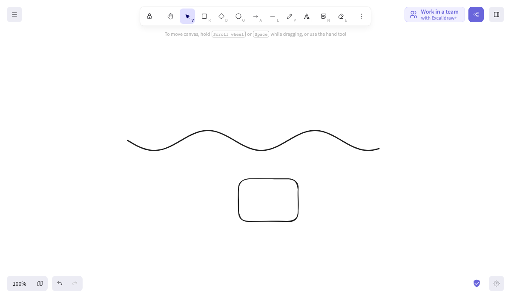
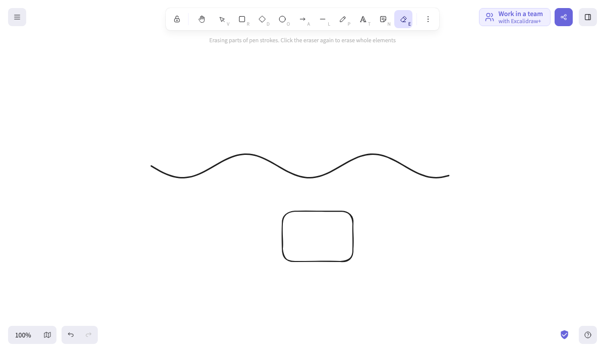
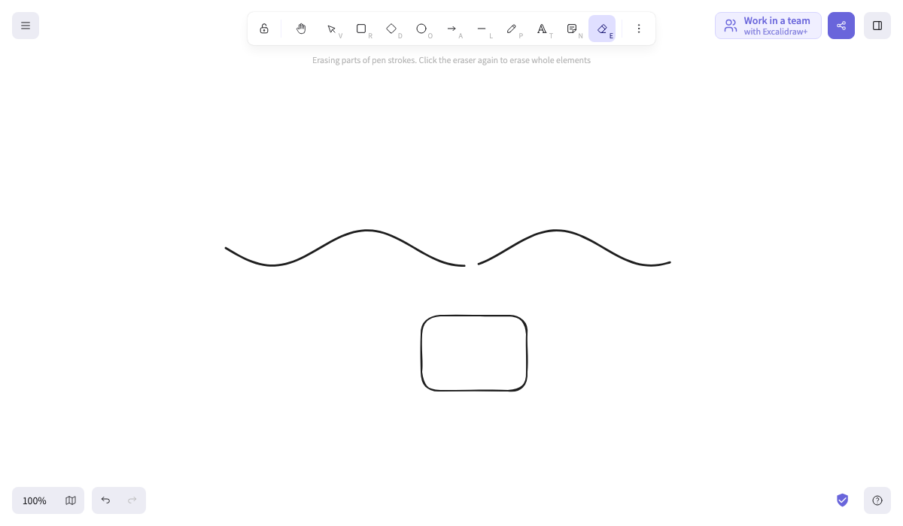

# Part 4: Code Complete

## 1. It works, shown in the running app

The demo runs against the real `excalidraw-app` dev server (`vite`, port 3001), driven by headless Chromium (Playwright) with real mouse events. The script is [`demo/demo.mjs`](demo/demo.mjs) and its output is [`demo/demo-output.txt`](demo/demo-output.txt):

```
before: [ 'freedraw:nHHI4a', 'rectangle:SjpETV' ]
eraserMode: partial | button label: Eraser (partial: cuts pen strokes) | hint: Erasing parts of pen strokes. Click the eraser again to erase whole elements
after: [ 'freedraw:O3Yhac', 'freedraw:vKDxzX', 'rectangle:SjpETV' ]
after undo: [ 'freedraw:nHHI4a', 'rectangle:SjpETV' ]
page errors: none
```

| Step | Screenshot |
| --- | --- |
| A freehand stroke and a rectangle |  |
| Eraser selected, then clicked again: partial mode. The hint bar says so. |  |
| One vertical drag across both: the stroke is cut in two, and the rectangle the eraser crossed is untouched |  |
| One `Cmd+Z`: the original stroke is back, with its original id |  |

This also covers the manual test that the contributing guide asks for (see [PROJECT-RULES.md](PROJECT-RULES.md)). The demo ran in Chromium only. The guide's "consider testing your change in multiple browsers" is not done.

**Found while demonstrating:** before Part 4, the hint bar still said _"Hold Alt to revert the elements marked for deletion"_ in partial mode. In that mode nothing is marked and Alt does nothing, so the help text was wrong. It now shows a partial-mode hint. A system test covers it (`"explains the active eraser mode in the hint bar"`), and the CHANGELOG mentions it. That test was written after the fix, not before it.

## 2. Linter and formatter, with the project's configuration

These are the commands CI runs (`.github/workflows/lint.yml`), on the final branch:

| Check | Command | Result |
| --- | --- | --- |
| ESLint | `yarn test:code` → `eslint --max-warnings=0 --ext .js,.ts,.tsx .` | exit 0 |
| Types | `yarn test:typecheck` → `tsc` | exit 0 |
| Prettier | `yarn test:other` → `prettier --list-different "**/*.{css,scss,json,md,html,yml}"` | Every file this branch adds or changes passes. The repo as a whole fails only on 1,146 pre-existing course files under `docs/` (see PROJECT-RULES.md). |
| Tests | `yarn test:app --watch=false` → `vitest run` | see §5 |

## 3. Nothing unrelated in the diff

I checked `git diff master..feat/partial-eraser`:

- **No debug output.** There is no `console.*`, `debugger`, `.only` or `.skip` in any added line.
- **No commented-out code.** The only added `//` lines are explanatory comments.
- **No stray reformatting.**
  - `git diff -w --stat` and `git diff --stat` match (22 source files, same line counts), so no hunk is whitespace-only.
  - The one formatting change I had introduced, an extra blank line in `Tools.tsx`'s imports left behind when ESLint reordered them, is removed.
- **No editor or build artifacts.** No `.vscode/`, `.idea/`, `dist/`, `build/`, coverage output or `.DS_Store` is committed. The Playwright browser was installed in a temporary folder outside the repo.
- **Generated files that do belong in the diff:** the three `.snap` files. Their only change is 133 added `"eraserMode": "element",` lines, which is required by the new AppState key.
- **Evidence files** under `docs/final-project/` are the course deliverable, not part of the feature. They are in their own commit, separate from the code. The 5,898-line raw test log was cut to a 169-line excerpt.

## 4. Documentation where the project expects it

| Place | Expected? | Done |
| --- | --- | --- |
| `packages/excalidraw/CHANGELOG.md` | Yes. Its guideline says every change goes under a section. | Yes, under `## Unreleased`: the new `appState.eraserMode`, the behavior, and the hint. Still missing a PR link, since there is no PR yet. |
| JSDoc on public types | Yes. Recent `AppState` fields (`preferredSelectionTool`, `minimapEnabled`) are documented this way. | Yes, `AppState.eraserMode` in `types.ts`. |
| Help text and UI strings | Yes. All labels go through `locales/en.json`, and other languages come from Crowdin. | `toolBar.eraserPartial`, `labels.toggleEraserMode` and `hints.eraserPartial`. Only `en.json` is edited, as the contributing guide sends translations to Crowdin. |
| Help dialog (`?`) | Only for keyboard shortcuts | Not changed. The mode has no shortcut, and the eraser's `E`/`0` entry is unchanged. |
| `README.md`, `packages/excalidraw/README.md` | No. They link to the external docs site and don't list `AppState` fields. | Not changed |
| `dev-docs/` | No. Its README says: _"The developer docs have moved to plus.excalidraw.com/docs/sdk … changes here are no longer published."_ | Not changed. The external API docs are outside this repo. |

## 5. Final test run

```
$ ./node_modules/.bin/vitest run
 Test Files  159 passed (159)
      Tests  2823 passed | 47 skipped | 1 todo (2871)
exit code 0
```

This is 2,823 passing tests: 2,822 from Part 3 plus the new hint-bar test. The full output is in [`full-suite-final.txt`](full-suite-final.txt), which Part 4 regenerated. After the Part 5 self-review fixes, the suite was re-run: 2,826 passing tests (159 files, exit 0). [`full-suite-final.txt`](full-suite-final.txt) now holds that run.

## 6. History

There were five rounds of work over Parts 1–4, and they show up as only three commits on `feat/partial-eraser`. Each commit is something a reviewer would want to receive on its own.

1. `docs(repo): add design note for the partial eraser`
2. `feat(editor): add a partial eraser mode that cuts freedraw strokes`: all code, tests, snapshots, strings and the CHANGELOG entry, built and passing in one commit
3. `docs(repo): record the partial eraser build, project rules, demo and review`: the course write-ups and evidence
4. `docs(repo): add pull request description for the partial eraser`: added in Part 6 (`docs/PR.md`). The Part 5 self-review fixes were folded into commit 2, the same way, and are listed in [SELF-REVIEW.md](SELF-REVIEW.md).

Back-and-forth that was **squashed out of commit 2**:

- the Part 3 test renames and the allocation-free hit-test rewrite
- the Part 4 hint fix
- the import blank-line fix

The Red/Green steps are not separate commits. Unlike A7, where the red-green-refactor history _was_ the deliverable, here they are recorded with their saved output in [BUILD.md](BUILD.md). An upstream maintainer would not want commits that each leave a failing test on the branch. The branch was rebuilt from `master` with a soft reset and three path-scoped commits. It had never been pushed, so no shared history was rewritten.
