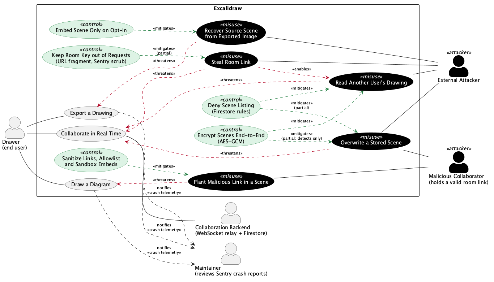

# Misuse Cases

This page extends the [use case diagram](requirements-and-use-cases.md#part-5-use-case-diagram) with attacker behaviour. Line references are as of commit `40c1bdf53`.

## Part 1: Misuse Case Diagram

Source: [`docs/misuse-case-diagram.puml`](misuse-case-diagram.puml) (PlantUML), rendered at [`docs/misuse-case-diagram.png`](misuse-case-diagram.png).

**Notation:** misuse cases are black (the inverse of normal use cases), controls are green, and both attacker actors sit outside the system boundary.

Excalidraw has no accounts, logins or roles, so a session cannot be stolen and privileges cannot be escalated in the usual sense. The nearest equivalent is the collaboration link: it carries the room ID and the encryption key (`excalidraw-app/data/index.ts:163`), and anyone holding it has full access to the room.

### Attackers

- **External Attacker:** has no legitimate access to the room. They may have obtained a room ID, a link or an exported file.
- **Malicious Collaborator:** was given a valid room link, so encryption does not stop them.

### Misuse cases and mitigations

| Misuse case | Threatens | Attacker | Control | Mitigates? |
| --- | --- | --- | --- | --- |
| **Steal Room Link** | Collaborate in Real Time | External Attacker | **Keep Room Key out of Requests:** the key is in the URL fragment, which browsers do not send to servers, and `beforeSend` removes the fragment from the Sentry request URL (`excalidraw-app/sentry.ts:41`). | Partial. A link that leaks through chat, a screenshot or browser history still works, and I found no way to revoke it. |
| **Read Another User's Drawing** | Collaborate in Real Time | External Attacker | **Encrypt Scenes End-to-End:** scenes are encrypted with AES-GCM before they reach the relay or Firestore (`excalidraw-app/collab/Portal.tsx:93`, `excalidraw-app/data/firebase.ts:99`). **Deny Scene Listing:** `allow list: if false` stops anyone enumerating rooms (`firebase-project/firestore.rules:7`). | Yes, unless the attacker has the link. That is why Steal Room Link *enables* this misuse case. |
| **Overwrite a Stored Scene** | Collaborate in Real Time | External Attacker, Malicious Collaborator | **Encrypt Scenes End-to-End:** without the key, a forged scene fails AES-GCM decryption (`excalidraw-app/data/firebase.ts:219`, `:262`). **Deny Scene Listing:** the attacker has to learn a room ID first. | Partial. See the gap below. |
| **Plant Malicious Link in a Scene** | Draw a Diagram | Malicious Collaborator | **Sanitize Links, Allowlist and Sandbox Embeds:** links are normalized when a scene is restored (`packages/excalidraw/data/restore.ts:511`, `packages/common/src/url.ts:10`), embeds must match an allowlist (`packages/element/src/embeddable.ts:133`), and they render in a sandboxed iframe (`packages/excalidraw/components/App.tsx:2052`). | Yes for script URLs: `sanitizeUrl` returned `about:blank` for the `javascript:` and `data:` test values. A normal `https://` link to a phishing page still passes. |
| **Recover Source Scene from Exported Image** | Export a Drawing | External Attacker | **Embed Scene Only on Opt-In:** `exportEmbedScene` defaults to `false` (`packages/excalidraw/appState.ts:71`), so scene data is only written into the file if the Drawer turns it on (`packages/excalidraw/scene/export.ts:378`). | Yes by default. If the option is on, anyone with the file can recover the exported elements. |

### Known gap: scene writes are not access-controlled

The Firestore rules allow `get` and `write` for anyone who knows the document path (`firebase-project/firestore.rules:5`). The storage rules do the same for room and share-link files (`firebase-project/storage.rules`). So:

- **An External Attacker with only a room ID** cannot read the scene or insert believable content, but can replace the stored scene with garbage. Decryption then fails, and from reading `saveToFirebase` and its caller (`excalidraw-app/collab/Collab.tsx:339`), later saves for that room should show an error. Encryption detects this attack but does not prevent it.
- **A Malicious Collaborator** has the key, so they can write a validly encrypted replacement that other clients accept as genuine. No control in the diagram stops this.

The gap and the failure behaviour come from reading the code. I did not test them against a live backend. The WebSocket relay is not in this repository, so its access controls were not reviewed.
