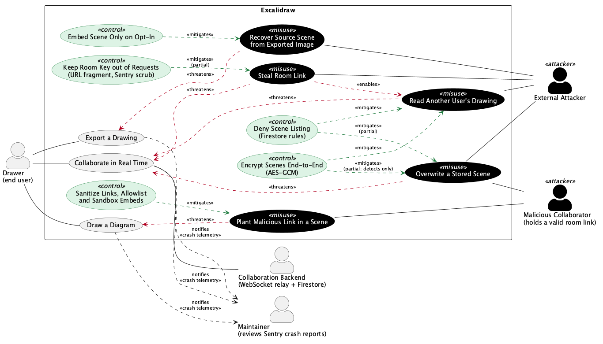
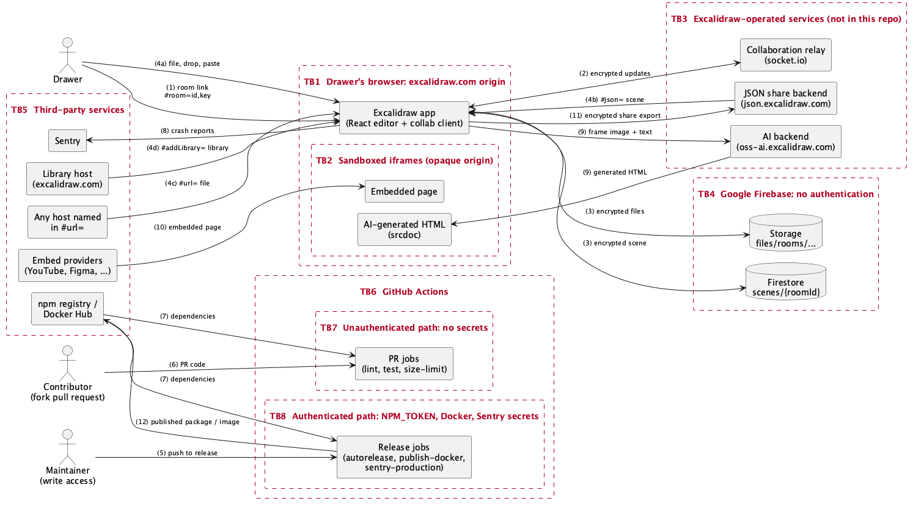

# Security Analysis

Security analysis of Excalidraw for Assignment A5. Part 1 extends the [use case diagram](requirements-and-use-cases.md#part-5-use-case-diagram) with attacker behaviour. Code line references are as of commit `40c1bdf53`.

## Part 1: Misuse Case Diagram

Source: [`docs/misuse-case-diagram.puml`](misuse-case-diagram.puml) (PlantUML), rendered at [`docs/misuse-case-diagram.png`](misuse-case-diagram.png).

**Notation:** misuse cases are black (the inverse of normal use cases), controls are green, and both attacker actors sit outside the system boundary.

Excalidraw has no accounts, logins or roles, so a session cannot be stolen and privileges cannot be escalated in the usual sense. The nearest equivalent is the collaboration link: it carries the room ID and the encryption key (`excalidraw-app/data/index.ts:163`), and anyone holding it has full access to the room.

### Attackers

- **External Attacker:** has no legitimate access to the room. They may have obtained a room ID, a link or an exported file.
- **Malicious Collaborator:** was given a valid room link, so encryption does not stop them.

### Misuse cases and mitigations

| Misuse case | Threatens | Attacker | Control | Mitigates? |
| --- | --- | --- | --- | --- |
| **Steal Room Link** | Collaborate in Real Time | External Attacker | **Keep Room Key out of Requests:** the key is in the URL fragment, which browsers do not send to servers, and `beforeSend` removes the fragment from the Sentry request URL (`excalidraw-app/sentry.ts:41`). | Partial. A link that leaks through chat, a screenshot or browser history still works, and I found no way to revoke it. The Sentry scrub also misses navigation breadcrumbs (see [Part 2](#misuse-case-steal-room-link)). |
| **Read Another User's Drawing** | Collaborate in Real Time | External Attacker | **Encrypt Scenes End-to-End:** scenes are encrypted with AES-GCM before they reach the relay or Firestore (`excalidraw-app/collab/Portal.tsx:93`, `excalidraw-app/data/firebase.ts:99`). **Deny Scene Listing:** `allow list: if false` stops anyone enumerating rooms (`firebase-project/firestore.rules:7`). | Yes, unless the attacker has the link. That is why Steal Room Link *enables* this misuse case. |
| **Overwrite a Stored Scene** | Collaborate in Real Time | External Attacker, Malicious Collaborator | **Encrypt Scenes End-to-End:** without the key, a forged scene fails AES-GCM decryption (`excalidraw-app/data/firebase.ts:219`, `:262`). **Deny Scene Listing:** the attacker has to learn a room ID first. | Partial. See the gap below. |
| **Plant Malicious Link in a Scene** | Draw a Diagram | Malicious Collaborator | **Sanitize Links, Allowlist and Sandbox Embeds:** links are normalized when a scene is restored (`packages/excalidraw/data/restore.ts:511`, `packages/common/src/url.ts:10`), embeds must match an allowlist (`packages/element/src/embeddable.ts:133`), and they render in a sandboxed iframe (`packages/excalidraw/components/App.tsx:2052`). | Yes for script URLs: `sanitizeUrl` returned `about:blank` for the `javascript:` and `data:` test values. A normal `https://` link to a phishing page still passes. |
| **Recover Source Scene from Exported Image** | Export a Drawing | External Attacker | **Embed Scene Only on Opt-In:** `exportEmbedScene` defaults to `false` (`packages/excalidraw/appState.ts:71`), so scene data is only written into the file if the Drawer turns it on (`packages/excalidraw/scene/export.ts:378`). | Yes by default. If the option is on, anyone with the file can recover the exported elements. |

### Known gap: scene writes are not access-controlled

The Firestore rules allow `get` and `write` for anyone who knows the document path (`firebase-project/firestore.rules:5`). The storage rules do the same for room and share-link files (`firebase-project/storage.rules`). So:

- **An External Attacker with only a room ID** cannot read the scene or insert believable content, but can replace the stored scene with garbage. Decryption then fails, and from reading `saveToFirebase` and its caller (`excalidraw-app/collab/Collab.tsx:339`), later saves for that room should show an error. Encryption detects this attack but does not prevent it.
- **A Malicious Collaborator** has the key, so they can write a validly encrypted replacement that other clients accept as genuine. No control in the diagram stops this.

The gap and the failure behaviour come from reading the code. I did not test them against a live backend. The WebSocket relay is not in this repository, so its access controls were not reviewed.

## Part 2: Fully-Dressed Misuse Cases

### Misuse Case: Steal Room Link

**Attacker:** External Attacker. This is an outsider who was never invited to the room, such as someone who can read the chat or ticket where the link was posted, or who uses the same computer as a Drawer. They want to read a private drawing and keep following it without anyone noticing.

**Threatens:** Collaborate in Real Time. It also enables Read Another User's Drawing.

**Preconditions:**
- A Drawer has started a live collaboration session, so a link containing both the room ID and the encryption key exists.
- The link is somewhere the attacker can reach it, such as a chat, ticket, screenshot, browser history or Sentry event.
- The session is still live, or its scene is still stored in Firestore.

**Attack Scenario:**
1. A Drawer starts a session. The system generates a room ID and key and pushes a URL containing both into the address bar and browser history (`excalidraw-app/collab/Collab.tsx:501`, `:502`).
2. The Drawer shares the link somewhere the attacker can read it.
3. The attacker copies the link.
4. The attacker opens the link. The app reads the room ID and key from the fragment, checking only that the key is 22 characters long (`excalidraw-app/App.tsx:250`, `excalidraw-app/data/index.ts:138`).
5. The client joins the room by sending only the room ID. No login, invitation or host approval is involved (`excalidraw-app/collab/Portal.tsx:45`).
6. The client receives the encrypted scene from a peer or from Firestore and decrypts it with the stolen key (`excalidraw-app/collab/Portal.tsx:49`, `excalidraw-app/collab/Collab.tsx:734`).
7. The attacker reads the drawing and receives each later update while connected.
8. After the Drawer ends the session, the attacker can still use the link. Ending a session saves the scene and does not delete it (`excalidraw-app/collab/Collab.tsx:365`), and I found no code that deletes a stored scene.

**Variation at step 5:** the attacker skips the socket and reads `scenes/{roomId}` directly, which the rules allow (`firebase-project/firestore.rules:5`), then decrypts it offline. They never appear in the collaborator list, but they only get the last saved scene.

**Intervention Points:**

| Step | Control that could stop it | Status today |
| --- | --- | --- |
| 1 | **Keep the key out of telemetry:** add a `beforeBreadcrumb` hook to `excalidraw-app/sentry.ts` that strips the fragment from navigation breadcrumbs. | **Partial.** The fragment is not sent to servers in requests, and `beforeSend` scrubs the Sentry request URL (`excalidraw-app/sentry.ts:41`). The breadcrumb is not scrubbed, so a crash report sent after a room is created can contain the key. This only exposes the key to someone with access to the Sentry data. |
| 2 | **Separate the key from the link:** share the key or a room password through a second channel, so that one leaked message is not enough. | Missing. |
| 5 | **Check access on join:** require an invitation or host approval, enforced by the backend. | Missing. Excalidraw has no accounts, so this would be a significant design change. The relay is not in this repository, so I could not review what it enforces. |
| 5 | **Show who is present:** the attacker appears in the collaborator list (`excalidraw-app/collab/Collab.tsx:875`). | Exists, but it only detects the attack and does not stop it. Usernames are not verified, and the Firestore variation avoids the list entirely. |
| 8 | **Expire links:** delete the stored scene when the session ends, or set an expiry and let the host rotate the key. | Missing. |

Encryption cannot intervene at step 6 because the attacker holds the real key. Deny Scene Listing does not help either, because the link already contains the room ID.

**Consequence:**
- **The attacker gains:** the full plaintext drawing and later updates while connected. Because the link grants full access, they can also edit the room.
- **The Drawer and other users lose:** the confidentiality that end-to-end encryption was meant to give them. There is no revocation, and I found no access log in this repository, so they may never find out.

### Misuse Case: Overwrite a Stored Scene

**Attacker:** Malicious Collaborator. This is someone who was legitimately given the link, such as a contractor or former teammate. They want to silently change what a shared drawing says, such as a figure in a plan or a step in a design, or to destroy the work.

**Threatens:** Collaborate in Real Time.

**Preconditions:**
- The attacker holds a valid room link, so they have both the room ID and the key.
- The scene has been saved to Firestore at least once.
- The Firestore rules allow anyone to write to a known document path (`firebase-project/firestore.rules:5`).
- The attacker has the Firebase project configuration, which is public because it ships in the client build (`.env.production:17`).

**Attack Scenario:**
1. The attacker opens the room link and joins as an ordinary collaborator (`excalidraw-app/collab/Portal.tsx:45`).
2. The attacker's client decrypts the scene, which shows every element's ID and version.
3. The attacker builds a replacement scene that reuses those element IDs, changes their content and sets a higher `version` on each one.
4. The attacker encrypts the replacement with the room key, using the same AES-GCM scheme as the app (`excalidraw-app/data/firebase.ts:99`).
5. The attacker bypasses the app and writes the result directly to `scenes/{roomId}`. The rules accept it without checking who wrote it or what it contains.
6. An honest Drawer's client next saves the room. It reads the attacker's document and decrypts it successfully, because it was encrypted with the real key (`excalidraw-app/data/firebase.ts:219`).
7. Reconciliation keeps the attacker's elements because their version is higher, unless the Drawer is editing that element at that moment (`packages/excalidraw/data/reconcile.ts:35`).
8. The honest client saves the merged result back to Firestore and applies it to its own canvas (`excalidraw-app/data/firebase.ts:234`, `excalidraw-app/collab/Collab.tsx:337`). The change looks like a normal collaborator's edit.
9. Anyone who later loads the room from Firestore receives the tampered scene (`excalidraw-app/data/firebase.ts:249`).

**Variation at step 3:** an External Attacker with only the room ID cannot encrypt a valid replacement. Their write fails decryption at step 6, so clients should show a save error instead of accepting it, as described in the [known gap](#known-gap-scene-writes-are-not-access-controlled). This is still a working denial-of-service attack. `write` also covers delete, so they could remove the document too.

**Intervention Points:**

| Step | Control that could stop it | Status today |
| --- | --- | --- |
| 1 | **Remove a collaborator:** let the host remove someone and rotate the room key, so an old link stops working. | Missing. I found no revocation or key rotation code. |
| 5 | **Restrict writes in the Firestore rules:** require an authenticated identity with membership of the room. | Missing, and this is the strongest fix. `allow write: if true` applies to every document, and the app uses neither Firebase Auth nor App Check. It would need some form of user identity, which Excalidraw does not have today. |
| 5 | **App Check:** reject writes that do not come from the genuine app. | Missing. This would stop simple scripted writes, but not a determined attacker who can drive or modify a real client. |
| 7 | **Sign each edit per user:** clients reject elements that the claimed author did not sign, or at least attribute them. | Missing. All collaborators share one symmetric key, so AES-GCM shows that a scene was written by a key holder, not which one. |
| 8–9 | **Keep scene history:** retain earlier versions so that tampering can be reversed. This repairs the damage rather than preventing it. | Missing from this repository. I do not know whether the production Firebase project keeps backups. |

Encrypt Scenes End-to-End does not intervene at any step because the attacker holds the key. Deny Scene Listing does not help because the attacker already knows the room ID. This is why no control in the diagram mitigates this attacker.

**Consequence:**
- **The attacker gains:** the ability to change a shared record while appearing as nobody in particular, because writes carry no identity. Honest clients also spread the change for them.
- **The Drawer and other users lose:** the integrity of the drawing and the ability to trust it, along with the original content if no other copy exists. Local browser saving is paused during collaboration (`excalidraw-app/collab/Collab.tsx:516`), so a Drawer's local storage may not hold a recent copy.

### How these were checked

- **Tested:** the Sentry breadcrumb leak. I ran the installed `@sentry/browser` 9.0.1 under jsdom with the app's `beforeSend` logic copied in and an in-memory transport, so nothing was sent anywhere. After a `pushState` to a room URL and a simulated error, `request.url` was clean, but the event's navigation breadcrumb contained `/#room=<id>,<key>`. This was a test of the SDK with the same scrub, not of the deployed app, and I do not know whether Sentry's servers scrub the value after receiving it.
- **Read but not run:** everything else, including both attack scenarios. I deliberately did not write to a real Firestore project. The rules described are the ones in this repository, and the production project's rules could differ.

## Part 3: Trust Boundary Diagram

Source: [`docs/trust-boundary-diagram.puml`](trust-boundary-diagram.puml) (PlantUML), rendered at [`docs/trust-boundary-diagram.png`](trust-boundary-diagram.png).

**Notation:** each dashed red box is a trust boundary (TB1–TB8), and each numbered arrow is a place where data crosses one. Crossings 1–5 are the entry points used in the threat model.

### Boundaries

- **TB1, Drawer's browser:** the app's own code, running in the excalidraw.com origin. Everything the Drawer opens, drops or pastes enters here.
- **TB2, sandboxed iframes:** embedded pages and AI-generated HTML run inside the browser but in a separate origin, so they cannot read the app's data.
- **TB3, Excalidraw-operated services:** the collaboration relay, JSON share backend and AI backend. Their code is not in this repository, so I cannot say what they validate. The client does not trust them with scene content and encrypts scenes before sending them, except at crossing 9.
- **TB4, Firebase:** the app's data store, run by Google, governed by the rules in `firebase-project/`.
- **TB5, third-party services:** Sentry, embed providers, the library host, any host named in a `#url=` link, and the npm and Docker registries.
- **TB6–TB8, GitHub Actions:** the CI pipeline, split into an unauthenticated path (TB7, fork pull request jobs with no secrets) and an authenticated path (TB8, release jobs holding the publishing secrets).

**Authenticated and unauthenticated paths:** the application has no authenticated path. No crossing into TB1, TB3 or TB4 checks who the user is, and the closest substitute is holding the room key. The only authenticated path in the project is CI, where pushing to `release` requires GitHub write access and only that path receives the publishing secrets.

### Crossings

| # | Crossing | What is validated | Validated by |
| --- | --- | --- | --- |
| 1 | Room link opened from a URL (Drawer → TB1) | Format only: the fragment must match `#room=<id>,<key>` and the key must be 22 characters (`excalidraw-app/data/index.ts:131`, `:141`). **Nothing checks who is opening the link.** | App |
| 2 | Relay messages (TB3 ⇄ TB1) | AES-GCM decryption proves the sender holds the room key (`excalidraw-app/collab/Collab.tsx:458`), then `restoreElements` normalizes elements and links (`excalidraw-app/collab/Collab.tsx:771`). **Nothing checks which collaborator sent a message, and element version numbers are trusted as sent** (`packages/excalidraw/data/reconcile.ts:35`). | App; the relay's own checks are unknown |
| 3 | Firestore and Storage (TB4 ⇄ TB1) | **Nothing on the server side.** The rules let anyone get or write a known path and deny only listing (`firebase-project/firestore.rules:5`, `:7`; `firebase-project/storage.rules`). The client decrypts and restores scenes and files with the room key (`excalidraw-app/data/firebase.ts:219`, `:256`, `:292`). The 4 MiB file limit is checked only by the client (`excalidraw-app/data/FileManager.ts:255`), so the store does not enforce it. | App only |
| 4a | File open, drag and drop, paste (Drawer → TB1) | Scenes are parsed and restored, which normalizes links (`packages/excalidraw/data/restore.ts:511`). Images must be a supported type (`packages/excalidraw/data/blob.ts:131`). SVGs are parsed (`packages/element/src/image.ts:104`) and drawn through an `` element (`packages/element/src/image.ts:30`), where scripts do not run. Pasted HTML is parsed with `DOMParser` (`packages/excalidraw/clipboard.ts:239`), which does not run scripts. | App |
| 4b | `#json=` share link (TB3 → TB1) | The scene is decrypted with the key from the link and restored (`excalidraw-app/data/index.ts:202`). If a scene is already open, the Drawer is asked before it is replaced (`excalidraw-app/App.tsx:259`). | App |
| 4c | `#url=` link (TB5 → TB1) | **The URL is not checked against any allowlist.** The app fetches whatever host the link names (`excalidraw-app/App.tsx:231`, `:309`). Only the file format is checked, and the Drawer is asked only if the canvas is not empty (`excalidraw-app/App.tsx:313`). | App, format only |
| 4d | `#addLibrary=` link (TB5 → TB1) | The URL must match an allowlist (`packages/excalidraw/data/library.ts:54`, `:497`), and the Drawer is prompted unless the link was issued for this editor (`packages/excalidraw/data/library.ts:740`). | App |
| 5 | Push to `release` (Maintainer → TB8) | GitHub requires write access. The release workflows start on any push to `release` (`.github/workflows/autorelease-excalidraw.yml:2`). No review gate is visible in the repository, though branch protection may be configured in GitHub settings, which I cannot see. | GitHub |
| 6 | Fork pull request (Contributor → TB7) | GitHub withholds repository secrets from `pull_request` jobs on forks, and no workflow uses `pull_request_target`. The pull request's code runs unreviewed, which is acceptable only because there are no secrets in that path. | GitHub |
| 7 | Dependencies (npm → TB7, TB8) | `yarn.lock` integrity hashes check that packages match the lockfile. **Nothing reviews what the packages contain.** The release job also runs `yarn add @actions/core -W` after writing `NPM_TOKEN` into the npm config (`.github/workflows/autorelease-excalidraw.yml:21`, `:26`), so it installs a version not pinned by the lockfile in the one job that holds the publishing token. | Yarn |
| 8 | Crash reports (TB1 → Sentry) | `beforeSend` removes the fragment from the request URL (`excalidraw-app/sentry.ts:41`). **Navigation breadcrumbs are not scrubbed, so the room key can be sent** (tested; see [How these were checked](#how-these-were-checked)). | App |
| 9 | AI backend (TB1 ⇄ TB3, response into TB2) | **Nothing validates the returned HTML.** It is rendered in a `srcdoc` iframe whose sandbox omits `allow-same-origin` (`packages/excalidraw/components/App.tsx:1841`, `:2052`), so its scripts run in an opaque origin and cannot read the app's data. In the other direction, an image of the frame and its text are sent unencrypted, apart from HTTPS (`excalidraw-app/components/AI.tsx:53`). Unlike at crossings 2, 3 and 11, the backend sees the drawing content. | Browser sandbox |
| 10 | Embedded pages (TB5 → TB2) | The embed URL must match a domain allowlist (`packages/element/src/embeddable.ts:133`), and the page runs in a sandboxed iframe (`packages/excalidraw/components/App.tsx:2052`). The sandbox still allows scripts, forms and popups. | App and browser |
| 11 | Share link export (TB1 → TB3) | The scene is compressed and encrypted with a new key before upload, and the key stays in the link fragment (`excalidraw-app/data/index.ts:248`). | App |
| 12 | Publish (TB8 → npm, Docker Hub) | The registries check the publishing credentials. | Registries |

### Findings

Each of these is a crossing where something goes unvalidated:

- **(1) and (2):** nothing identifies who is joining a room or who sent an edit, and element version numbers are taken on trust.
- **(3):** the data store validates nothing, so every check happens in a client that an attacker can bypass.
- **(4c):** a `#url=` link can load a scene from any host.
- **(7):** nothing reviews package contents, and the job holding `NPM_TOKEN` installs an unpinned package.
- **(8):** the room key can reach Sentry in a breadcrumb.
- **(9):** generated HTML is not validated, and the sandbox is the only control.

### Misplaced trust: decryption treated as proof of authorship

At crossings 2 and 3, the app treats anything that decrypts with the room key as a legitimate edit from a collaborator. AES-GCM only proves that the writer holds the key, and every collaborator shares the same key. After decrypting, the app also trusts each element's `version` number to decide which edit wins (`packages/excalidraw/data/reconcile.ts:35`), and nothing checks that number either.

**What it should verify:** who wrote the data, and that version numbers increase plausibly. Per-user signing keys on the client, and Firestore rules that only accept writes from authenticated room members, would let it do that.

**If the trust is misplaced:** anyone who has ever held the link, such as a former collaborator or someone who found it in a chat, can write a scene with inflated version numbers. Every honest client accepts it, applies it to its canvas and saves it back to Firestore, so the tampered version spreads and replaces the original with no record of who changed it. Part 2's Overwrite a Stored Scene walks through this step by step. The rules at crossing 3 do not check identity either, so nothing on either side of the boundary catches it.

**How this was checked:** by reading the code and workflow files, at the same commit as the line references above. The relay, JSON share backend and AI backend are not in this repository, and I cannot see the repository's GitHub settings, so what they validate is unknown and is not credited to them above.

## Part 4: Threat Model

These are the three highest-scoring threats from the STRIDE grid, where risk is likelihood × impact on a 1–3 scale for each. OWASP categories are from the [Top 10:2025](https://owasp.org/Top10/2025/), with the [2021](https://owasp.org/Top10/2021/) number in brackets.

| # | Risk | Asset | STRIDE | OWASP | Likelihood | Impact | Score |
| --- | --- | --- | --- | --- | --- | --- | --- |
| 1 | Room link leaks and can never be revoked | Room link and encryption key | Information Disclosure | A04 Cryptographic Failures [A02:2021] | High (3) | High (3) | 9 |
| 2 | Stored scene overwritten by anyone who knows its path | Stored scenes and files | Tampering | A01 Broken Access Control [A01:2021] | Medium (2) | High (3) | 6 |
| 3 | Anyone holding the link is accepted as a collaborator | Collaboration session | Spoofing | A07 Authentication Failures [A07:2021] | High (3) | Medium (2) | 6 |

All three come from one design decision: the room link is the only credential. Risk 1 is about losing that credential, risk 3 is that it cannot tell people apart, and risk 2 is that the data store does not even ask for it.

### Risk 1: Room link leaks and can never be revoked

**Asset:** the room link and the AES-GCM key inside it. Holding the key gives full read and write access to the room.

**STRIDE:** Information Disclosure.

**OWASP:** A04:2025 Cryptographic Failures. The encryption itself is sound, but OWASP lists key management under this category, including keys that are not rotated, and that is where it fails. The key travels inside a shareable URL, never expires, cannot be rotated and can be written to a crash report (crossings 1 and 8). Putting the key in Sentry also falls under A09:2025 Security Logging and Alerting Failures, which covers sensitive data in logs.

**Likelihood: High.** The link is designed to be pasted into chats, tickets and email, and it stays in browser history. Nothing makes an old link stop working. The Sentry breadcrumb leak happens without anyone doing anything wrong.

**Impact: High.** One leaked link exposes the whole drawing, every later update and the ability to edit, and it enables risks 2 and 3.

**Architectural mitigation:**
- **Expiry and revocation belong in the collaboration backend: the relay's `join-room` handler and `firebase-project/firestore.rules`.** The backend keeps a record for each room with an expiry time and a key epoch. The relay refuses joins, and the rules refuse reads, for expired or superseded epochs. This control has to live on the server side of crossings 2 and 3, because a check in the client can simply be removed by an attacker who already has the link.
- **Key rotation belongs in the client, in `excalidraw-app/collab/Collab.tsx` next to where keys are generated (`:501`).** When the host rotates, the client generates a new key, re-encrypts the scene and shares a new link. The client is the right place because of end-to-end encryption: the server never holds the key, so it cannot rotate it. The server's job is only to stop serving the old epoch.
- **Telemetry scrubbing belongs in `excalidraw-app/sentry.ts`, as a `beforeBreadcrumb` hook next to `beforeSend` (`:39`).** That file is the single point every Sentry event and breadcrumb passes through. Scrubbing at each `pushState` call would miss any future call site, and scrubbing on Sentry's servers is too late because the key has already left the browser.

### Risk 2: Stored scene overwritten by anyone who knows its path

**Asset:** stored scenes in Firestore and files in Storage.

**STRIDE:** Tampering.

**OWASP:** A01:2025 Broken Access Control. The rules `allow get, write: if true` for every document (`firebase-project/firestore.rules:5`), and Storage does the same for room files. The server performs no authorization at all, so every access decision is left to a client the attacker controls. The client also accepts any element that decrypts and trusts its version number (`packages/excalidraw/data/reconcile.ts:35`). That adds A08:2025 Software or Data Integrity Failures.

**Likelihood: Medium.** It needs someone who has held the link and intends harm, plus a small script against the public Firebase configuration. An External Attacker with only the room ID can corrupt or delete the scene, but cannot make clients accept fake content.

**Impact: High.** The tampering is silent, it looks like a normal edit, honest clients re-save it, and no scene history exists to recover from. Part 2's Overwrite a Stored Scene shows the full attack.

**Architectural mitigation:**
- **Write authorization belongs in `firebase-project/firestore.rules` and `firebase-project/storage.rules`.** The rules should require `request.auth`, allow writes to `scenes/{roomId}` only from members listed for that room, and refuse deletes. The rules are the right place because they are the only component every write passes through, including writes from scripts that bypass the app, as in step 5 of the attack. A check in `excalidraw-app/data/firebase.ts` would protect only honest clients.
- **Recovery belongs in the data layer: make history append-only.** Write each save as a new document under `scenes/{roomId}/versions/`, which the rules allow to be created but never updated or deleted. Tampering can then be undone. This also has to be server-enforced, because a client-side backup is under the attacker's control too.
- **Authorship checks belong in the app layer, in `excalidraw-app/collab/Collab.tsx` `_reconcileElements` (`:771`), before elements reach `reconcileElements`.** Each collaborator signs their changes with a per-user key, and the client drops changes whose signature does not match a current member. This has to be in the client because the server only ever sees ciphertext and cannot inspect elements. It belongs in `excalidraw-app` rather than `packages/excalidraw/data/reconcile.ts` because the package is a library that other host apps use with their own trust models.

### Risk 3: Anyone holding the link is accepted as a collaborator

**Asset:** the collaboration session, meaning the collaborators' assumption that everyone in the room was invited.

**STRIDE:** Spoofing.

**OWASP:** A07:2025 Authentication Failures. The system never establishes who a participant is. The client joins by sending only the room ID (`excalidraw-app/collab/Portal.tsx:45`), and the name other people see is a random username that the participant can change (`excalidraw-app/collab/Collab.tsx:486`).

**Likelihood: High.** It needs nothing beyond the link, and links spread as described in risk 1.

**Impact: Medium.** On its own it gives an intruder presence and lets them pose as someone else. Most of the damage comes when it is combined with risks 1 and 2, which have their own scores.

**Architectural mitigation:**
- **Identity is issued by an auth service in the backend tier and checked by the relay on `join-room`.** Firebase Anonymous Auth would do for the app's no-account model. The client sends an ID token with `join-room` in `excalidraw-app/collab/Portal.tsx`, and the relay checks it against the room's member list, which the host controls. The check belongs at the relay because the relay is the gatekeeper for crossing 2. The client can only present a token; it cannot be trusted to judge its own.
- **The same identity feeds the Firestore rules through `request.auth`.** Risk 2's write authorization therefore depends on this risk being fixed first.
- **Display names belong in `Collab.setCollaborators` (`excalidraw-app/collab/Collab.tsx:875`), bound to the verified identity from the relay rather than a name the client chose.** Other collaborators can then see who is really present.
- **Host approval belongs in the share flow (`excalidraw-app/share/ShareDialog.tsx`).** The host sees join requests and can remove a member, which also triggers the key rotation from risk 1.

**Trade-off:** all of this gives up some of Excalidraw's "share a link, no sign-up" simplicity. Anonymous auth with host approval keeps the sign-up-free experience while still giving the server an identity to check.

**Just below the top three:** the release pipeline (crossings 5 and 7). Likelihood is low because pushing to `release` needs write access, but a malicious package published with `NPM_TOKEN` would reach every app that embeds `@excalidraw/excalidraw`. The control belongs in `.github/workflows/autorelease-excalidraw.yml`: pin the `@actions/core` install, move publishing to short-lived credentials, and require review on `release` through branch protection. This falls under A03:2025 Software Supply Chain Failures.

## AI Use Log

See [`docs/ai-use-log-a5-security-analysis.md`](ai-use-log-a5-security-analysis.md) for what Claude Code did versus what I did on this assignment.
